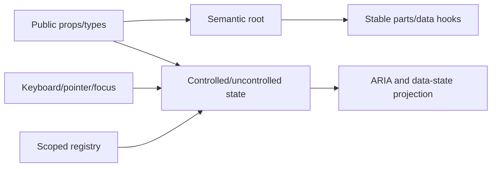

---
doc_meta:
  id: TDD-ui-platform-primitives-002
  title: Primitive Behavior and Polymorphism
  owner: UI Platform Team
  version: 1.0.0
  status: approved
  classification: public
  parent_sad: SAD-003
  review_cycle_days: 30
  created_date: 2026-09-28
  last_reviewed: 2026-10-02
---

# TDD-ui-platform-primitives-002: Primitive Behavior and Polymorphism

> **Revision pending exact-commit ratification.** Decisions P13 (one
> stability record per public entry, lien L4, with its data model), P14 (the
> reference slice), P15 (TextField), P16 (Dialog), and P17 (Tabs) are pending
> under GDC-000 section 2.6.7; the revision ratified on 2026-10-02 (`773a864`)
> remains binding until the authorized human authority approves the exact
> commit containing it.

## Purpose

Define an implementation-ready, style-agnostic contract for `@scnx/core-ui`:
semantic DOM, state ownership, keyboard/focus behavior, composition,
accessibility, cleanup, and stable styling hooks. Third-party behavior remains
private and Product business meaning remains outside the package.

## Scope

In scope: layout/typography primitives, Button/link behavior, Disclosure and
Accordion, navigation/TOC/sidebar structures, context/registry lifecycles,
Slot/`asChild`, closed `as` polymorphism, public types, refs, and behavior
evidence. Theme state and generic transition mechanics belong to the theme TDD;
visual variants belong to the styled TDD. Complex widgets not present in the
baseline remain Candidate until their own behavior matrices pass.

## Technical Context

The baseline mixes fixed elements, unrestricted generic `as`, and `asChild`;
has limited source tests; treats an anchor as `role=button`; may reuse a TOC
link ID as a heading target; exposes internal registry overrides; and has
unproven registration/remount races. These are findings to repair, not v1 API.

| ID      | Contract                                                                                                               |
| :------ | :--------------------------------------------------------------------------------------------------------------------- |
| PRM-001 | Native semantic elements are the default; ARIA never replaces available native behavior.                               |
| PRM-002 | Every stable interactive primitive has a versioned behavior matrix.                                                    |
| PRM-003 | Controlled and uncontrolled modes never switch silently and emit one callback per accepted change.                     |
| PRM-004 | Public IDs uniquely identify their own DOM node; references target a different matching ID.                            |
| PRM-005 | Component-only props are consumed and never leaked to DOM.                                                             |
| PRM-006 | Interactive composition uses approved `asChild`; layout/typography use a closed `as` union; no component exposes both. |
| PRM-007 | Consumer handler runs first; `preventDefault` cancels library action; refs are composed.                               |
| PRM-008 | Registration, listeners, observers, frames, and timers clean up under unmount and React Strict Mode.                   |

## Component Design

### Stable-candidate inventory

| Family                    | Semantic contract                                             | State/interaction owner             |
| :------------------------ | :------------------------------------------------------------ | :---------------------------------- |
| Box/Flex/Grid/Container   | `div` or closed semantic layout tag; no interaction           | consumer                            |
| Heading/Text/List/Divider | heading/text/list/separator semantics                         | consumer                            |
| Button                    | native `button`; link mode remains a semantic `a`             | native element + consumer           |
| Disclosure/Collapsible    | button controls one region; independent open state            | item/provider                       |
| Accordion                 | single/multiple disclosure orchestration                      | registry                            |
| Navigation/Navbar/Sidebar | `nav`/list/link/landmark structure                            | consumer except explicit disclosure |
| Table of Contents         | navigation links reference document headings; active tracking | TOC provider/tracker                |
| Transition                | generic lifecycle only                                        | theme TDD                           |

Combobox, Select, Menu, Dialog, Popover, Listbox, and Tabs require separate
matrix rows inside this TDD before promotion. Selected React Aria hooks may
implement them only after behavior, AT, provenance/license, and consumer-cost
evidence passes. Vendor types never cross the public boundary.

### Internal modules



Registries are scoped to the nearest provider and split state from imperative
API contexts to avoid unrelated rerenders. Internal advanced registry mutation
is not public v1 API.

### Decision record

Each decision names its sources (see References under Traceability) and the
tradeoff it accepts. A statement marked _inference_ has no normative source.

| ID  | Decision                                                                                                                                                                                                                                                                                                                                                                                                                                                                                                                                                                                                                                                                                                                                                                                                                                                                                                                                                                                                                                                                                                                       | Sources                                     | Tradeoff and residual risk                                                                                                                                                                                                                                                                                                                                                                                                                                                                                                                                                                                                                                                                                                                                                                                                                                                                                                                                                                                                                                                                                                                                                                                                                                                                                                                                                                                                                   |
| :-- | :----------------------------------------------------------------------------------------------------------------------------------------------------------------------------------------------------------------------------------------------------------------------------------------------------------------------------------------------------------------------------------------------------------------------------------------------------------------------------------------------------------------------------------------------------------------------------------------------------------------------------------------------------------------------------------------------------------------------------------------------------------------------------------------------------------------------------------------------------------------------------------------------------------------------------------------------------------------------------------------------------------------------------------------------------------------------------------------------------------------------------- | :------------------------------------------ | :------------------------------------------------------------------------------------------------------------------------------------------------------------------------------------------------------------------------------------------------------------------------------------------------------------------------------------------------------------------------------------------------------------------------------------------------------------------------------------------------------------------------------------------------------------------------------------------------------------------------------------------------------------------------------------------------------------------------------------------------------------------------------------------------------------------------------------------------------------------------------------------------------------------------------------------------------------------------------------------------------------------------------------------------------------------------------------------------------------------------------------------------------------------------------------------------------------------------------------------------------------------------------------------------------------------------------------------------------------------------------------------------------------------------------------------- |
| P1  | Layout primitives (Box, Flex, Grid, Container) render one tag of `LayoutTag`: `div`, `section`, `article`, `aside`, `header`, `footer`, `main`, `nav`, `span`. Headings use `HeadingTag` (`h1`–`h6`, `p`, `span`, `div`); text uses `TextTag` (`p`, `span`, `div`, `label`, `strong`, `em`, `small`, `figcaption`, `blockquote`, `cite`, `time`). No interactive tag is in any union.                                                                                                                                                                                                                                                                                                                                                                                                                                                                                                                                                                                                                                                                                                                                          | PRM-006; [3]                                | A consumer needing another tag nests an element; no layout primitive can acquire button or link semantics.                                                                                                                                                                                                                                                                                                                                                                                                                                                                                                                                                                                                                                                                                                                                                                                                                                                                                                                                                                                                                                                                                                                                                                                                                                                                                                                                   |
| P2  | `asChild` takes exactly one element child; child props win, `className` joins slot-then-child, style keys merge child-last, refs compose. For a handler on both, the consumer's runs first and `preventDefault` skips the library's.                                                                                                                                                                                                                                                                                                                                                                                                                                                                                                                                                                                                                                                                                                                                                                                                                                                                                           | PRM-007; [6]                                | No Slottable placeholder: a child cannot receive extra wrapper structure. The handler order matches Radix's `composeEventHandlers` [6].                                                                                                                                                                                                                                                                                                                                                                                                                                                                                                                                                                                                                                                                                                                                                                                                                                                                                                                                                                                                                                                                                                                                                                                                                                                                                                      |
| P3  | Button link mode is a native `a href` with no `role="button"`. Disabled, it drops `href`, sets `aria-disabled`, leaves sequential focus, and cancels activation without stopping propagation.                                                                                                                                                                                                                                                                                                                                                                                                                                                                                                                                                                                                                                                                                                                                                                                                                                                                                                                                  | [3]; API / Interface: Button                | A disabled link is not reachable by Tab; its reason must be visible elsewhere.                                                                                                                                                                                                                                                                                                                                                                                                                                                                                                                                                                                                                                                                                                                                                                                                                                                                                                                                                                                                                                                                                                                                                                                                                                                                                                                                                               |
| P4  | `CollapsibleBase` defaults to `type="multiple"`, `AccordionBase` to `type="single"`; `collapsible` defaults to `true`.                                                                                                                                                                                                                                                                                                                                                                                                                                                                                                                                                                                                                                                                                                                                                                                                                                                                                                                                                                                                         | [7]; baseline behavior                      | Radix requires an explicit `type` and defaults `collapsible` to `false` [7]. The defaults here keep the baseline behavior; a consumer who expects Radix semantics passes both props. Disposes review finding D4.                                                                                                                                                                                                                                                                                                                                                                                                                                                                                                                                                                                                                                                                                                                                                                                                                                                                                                                                                                                                                                                                                                                                                                                                                             |
| P5  | `AccordionBase.Header` wraps each trigger in a heading, `h3` by default, with a closed `HeadingTag` `as`.                                                                                                                                                                                                                                                                                                                                                                                                                                                                                                                                                                                                                                                                                                                                                                                                                                                                                                                                                                                                                      | [2]                                         | Radix sets the level through `asChild` [7]; a closed `as` keeps the header structural (PRM-006). The page owner chooses the level that fits its outline.                                                                                                                                                                                                                                                                                                                                                                                                                                                                                                                                                                                                                                                                                                                                                                                                                                                                                                                                                                                                                                                                                                                                                                                                                                                                                     |
| P6  | Accordion content is `role="region"` labelled by its trigger by default; `region={false}` removes the role.                                                                                                                                                                                                                                                                                                                                                                                                                                                                                                                                                                                                                                                                                                                                                                                                                                                                                                                                                                                                                    | [2]                                         | APG advises against regions when more than about six panels can be open at once [2]. That case needs the opt-out, so landmark proliferation stays possible if the opt-out is not used.                                                                                                                                                                                                                                                                                                                                                                                                                                                                                                                                                                                                                                                                                                                                                                                                                                                                                                                                                                                                                                                                                                                                                                                                                                                       |
| P7  | Accordion keyboard support is the native button (Enter, Space) and the Tab sequence. Arrow-key focus movement between headers is not implemented.                                                                                                                                                                                                                                                                                                                                                                                                                                                                                                                                                                                                                                                                                                                                                                                                                                                                                                                                                                              | [2]; [7]                                    | APG lists Enter, Space, and Tab only [2]; Radix adds ArrowUp/ArrowDown/Home/End [7]. Long accordions need more Tab presses. Candidate for a later revision.                                                                                                                                                                                                                                                                                                                                                                                                                                                                                                                                                                                                                                                                                                                                                                                                                                                                                                                                                                                                                                                                                                                                                                                                                                                                                  |
| P8  | A navigation item with a sub-group renders a native `button` with `aria-expanded` and `aria-controls`; a leaf renders a native `a href` with `aria-current="page"` when active. No `menu` role and no `aria-haspopup`. Router links compose through `asChild`.                                                                                                                                                                                                                                                                                                                                                                                                                                                                                                                                                                                                                                                                                                                                                                                                                                                                 | [1]; [5]                                    | The disclosure-navigation pattern [1] is not a menu, so arrow-key menu navigation is not offered. Disposes review finding D5 except arrow-key roving, which stays consumer-owned.                                                                                                                                                                                                                                                                                                                                                                                                                                                                                                                                                                                                                                                                                                                                                                                                                                                                                                                                                                                                                                                                                                                                                                                                                                                            |
| P9  | No redundant role on native elements (`nav`, `ul`, `li`, `aside`). The styled `List` adds `role="list"` only to its `unstyled` variant, outside a `nav`.                                                                                                                                                                                                                                                                                                                                                                                                                                                                                                                                                                                                                                                                                                                                                                                                                                                                                                                                                                       | [3]; [4]                                    | ARIA in HTML marks redundant roles NOT RECOMMENDED [3]. Safari/VoiceOver drops list semantics under `list-style: none` except inside `nav` [4], so the unstyled list keeps an explicit role.                                                                                                                                                                                                                                                                                                                                                                                                                                                                                                                                                                                                                                                                                                                                                                                                                                                                                                                                                                                                                                                                                                                                                                                                                                                 |
| P10 | A TOC item names its target heading by `targetId`; its link has `href="#<targetId>"` and its own optional `id`, never the heading's. The active link carries `aria-current="location"`.                                                                                                                                                                                                                                                                                                                                                                                                                                                                                                                                                                                                                                                                                                                                                                                                                                                                                                                                        | [8]; [5]                                    | IDs must be unique in a tree [8]. `location` follows the MDN definition [5]; no normative TOC guidance exists (_inference_).                                                                                                                                                                                                                                                                                                                                                                                                                                                                                                                                                                                                                                                                                                                                                                                                                                                                                                                                                                                                                                                                                                                                                                                                                                                                                                                 |
| P11 | The sidebar toggle controls its sidebar (`aria-controls`) and takes a required accessible name; the flyout is non-modal: Escape closes it and returns focus to the item that opened it, and focus is not trapped.                                                                                                                                                                                                                                                                                                                                                                                                                                                                                                                                                                                                                                                                                                                                                                                                                                                                                                              | [1]; STD-UIP-PRM-001                        | The toggle's name is localized by the consumer; no built-in English label remains.                                                                                                                                                                                                                                                                                                                                                                                                                                                                                                                                                                                                                                                                                                                                                                                                                                                                                                                                                                                                                                                                                                                                                                                                                                                                                                                                                           |
| P12 | Every stable-candidate interactive primitive has a versioned record in `packages/core-ui/behavior-inventory.json` (the PrimitiveContract shape). Source and packed tests read it.                                                                                                                                                                                                                                                                                                                                                                                                                                                                                                                                                                                                                                                                                                                                                                                                                                                                                                                                              | PRM-002                                     | The inventory is maintained with the component; a missing record fails the contract test rather than passing silently.                                                                                                                                                                                                                                                                                                                                                                                                                                                                                                                                                                                                                                                                                                                                                                                                                                                                                                                                                                                                                                                                                                                                                                                                                                                                                                                       |
| P13 | Every public JavaScript entry of both packages has exactly one stability record in `packages/core-ui/behavior-inventory.json`: an interactive primitive its PrimitiveContract (P12), every other entry one EntryStability record in `entries` (Data Model). An entry is `stable` only when the first stable release is authorized (TDD packaging RC3), its public-API report has been reviewed in a release (RC1), its packed fixtures pass in every engine of the support matrix (RC5), it has no open known limitation, and, for an `interactive` or `layout` entry, its behavior matrix passes and it has a Component ACR (Operational Notes). Until then it is `candidate`. The evidence packet fails on a public entry without a record, a record for an entry that is not public, and `unclassified`.                                                                                                                                                                                                                                                                                                                    | [9]; [10]; STD-UIP-ENG-001 3.4, 3.5         | Two levels match Primer's "Experimental" and "Ready" [9] and Angular's Developer Preview [10]; finer levels would add promises nobody can test yet. On 2026-10-19 all 46 entries (with TextField, P15) are `candidate`: no stable release is authorized and no Component ACR exists. The record states each entry's kind, so what stands between it and `stable` is visible, at the cost of one more list to keep with the exports (the evidence gate catches drift).                                                                                                                                                                                                                                                                                                                                                                                                                                                                                                                                                                                                                                                                                                                                                                                                                                                                                                                                                                        |
| P14 | The reference slice (PLAN P2) is: Button (the existing ButtonBase and Button); a TextField form control, a native `input` with a `label`, an optional description and an error message associated by `aria-describedby`, and `aria-invalid="true"` while in error; a Dialog overlay, the native `dialog` element opened with `showModal()`; and Tabs as the composite widget, after the APG Tabs pattern with automatic activation by default. Each of the three new families gets its own matrix row and PrimitiveContract here before it is implemented, and leaves `candidate` only under P13.                                                                                                                                                                                                                                                                                                                                                                                                                                                                                                                              | [11]; [12]; [13]; [14]; [15]; [16]; PLAN P2 | A composite widget is "A widget that may contain navigable descendants or owned children", whose subclasses are grid, select, spinbutton, and tablist [11]; Accordion is not one, so the slice adds Tabs, whose pattern is fully specified [12]. `showModal()` makes the rest of the document inert, puts the dialog in the top layer, and remembers the previously focused element [13], and `dialog` is Baseline Widely available since 2024-09-14 [14], inside the support matrix, while Popover is only newly available (2025-01-27) [14]; a hand-made focus trap is not needed and is not written. The TextField exercises the labelling and error duties every form shares [15][16]; a checkbox would exercise fewer. Automatic tab activation suits panels already rendered [12]; heavy panels need manual activation, which the Tabs row decides.                                                                                                                                                                                                                                                                                                                                                                                                                                                                                                                                                                                    |
| P15 | TextFieldBase renders one root `div` holding, in order, a native `label` whose `for` names the input, an optional description, the `input`, and an optional error message. The input `id` is the consumer's or `useId()`; the description and error carry `<id>-description` and `<id>-error`, listed in that order in the input's `aria-describedby`. A present `error` sets `aria-invalid="true"` on the input and `data-invalid` on the root; `disabled` and `required` are the native attributes, reflected as `data-disabled`. `label` is required and visible; `type` is one of text, email, password, search, tel, and url, and `inputMode` passes through. Keyboard and focus are the native input's. The styled TextField draws the boundary with the strong neutral border and the error state with the strong danger border and the error text.                                                                                                                                                                                                                                                                     | [15]; [16]; [17]; [18]                      | The browser computes the name from the `label` and the description from `aria-describedby`, so no ARIA role or name is invented [3][16]. The error is text, so colour is not its only cue; `aria-errormessage` is not used, since ARIA21 [16] covers the same need with wider support. `type="number"` is excluded: "Do not use `<input type="number">` unless your user research shows that there's a need for it", and `inputmode` is the advice for numbers [17]; a placeholder is never the label [17]. The strong neutral border was 2.99:1 against the light default surface, under the 3:1 of WCAG 1.4.11 [18]; STD-UIP-TKN-001 2.2.0 makes it the control boundary, the token gate tests it at 3:1, and the light neutral step 8 moved to L 0.63 (minimum 3.11:1). The strong danger border is 2.3:1 in dark mode, which 1.4.11 does not require because the error text carries the state.                                                                                                                                                                                                                                                                                                                                                                                                                                                                                                                                           |
| P16 | DialogBase wraps one native `dialog`, controlled by `open` and `onOpenChange`, and opens it only with `showModal()`, never with the `open` attribute; server markup renders it closed and an open dialog calls `showModal()` after hydration. The prop alone opens and closes the element: setting `open` to false calls `close()`. Escape fires `cancel`, which DialogBase cancels when the browser allows it and reports as `onOpenChange(false)` at once; `DialogBase.Close` reports the same; a `close` event the dialog did not request (a `method="dialog"` form) reports it while `open` is still true. The browser makes the rest of the document inert, renders the dialog in the top layer, moves focus into it, and returns focus to the previously focused element. `DialogBase.Title` (an `h2`) names the dialog through `aria-labelledby` and is required unless `aria-label` is given; `DialogBase.Description` adds `aria-describedby` while mounted; `DialogBase.Close` is a native button. There is no light dismiss. The dialog stays in place inside the theme root, so its tokens apply without a portal. | [12]; [13]; [14]; [19]; [20]                | Opening through `showModal()` is what makes the dialog modal for assistive technology: "If the open attribute is set via the showModal() method then aria-modal=\"true\"", while an `open` set any other way maps to `aria-modal="false"` [19]; so no `aria-modal` is written and the attribute is never rendered. Inert, top layer, and focus return come from the browser [13], so no focus trap is written. The `close` event is queued as a task while `cancel` fires synchronously [13]; reporting from `close` alone left the element closed while `open` was still true, and in Chromium a reopen in that interval was lost, so DialogBase reports from `cancel` and Close, and counts a `close` event only while the element is still closed: in Chromium the event of an earlier close arrived after a reopen and closed the new dialog. Light dismiss (`closedby`) is not Baseline [14]. The page behind is inert but can still scroll: locking it would need a rule on `html`, outside every theme root, which styled CSS forbids; that is an open known limitation. `::backdrop` inherits from its dialog in Chrome and Edge 122, Firefox 120, and Safari 17.4 [20], all older than the support matrix's oldest browsers, so the backdrop can use tokens. jsdom implements no `showModal()`; unit tests use a stub for open, close, and Escape, and the browsers prove the rest (Storybook, the packed matrix in three engines). |
| P17 | TabsBase follows the APG Tabs pattern. `TabsBase.List` is the `tablist` (named by `aria-label` or `aria-labelledby`; `aria-orientation="vertical"` only when vertical); each `TabsBase.Tab` is a native button with role `tab`, `aria-selected`, and `aria-controls`; each `TabsBase.Panel` is a `tabpanel` labelled by its tab, `tabindex="0"` by default, and `hidden` while not selected, but always rendered. Focus is roving: only the selected tab is in the Tab sequence. Left and Right Arrow (Up and Down when vertical) move focus to the previous and next enabled tab and wrap; Home and End move to the first and last. Activation is automatic by default, selecting the tab that receives focus; `activation="manual"` selects on Enter, Space, or click. Selection is `value` with `onValueChange`, or `defaultValue`; one tab is always selected. IDs derive from the root id and each tab's value.                                                                                                                                                                                                           | [11]; [12]                                  | APG recommends automatic activation "as long as their associated tab panels are displayed without noticeable latency", which "typically requires tab panel content to be preloaded" [12]; panels stay rendered and hidden, so automatic is the default and manual is the option for panels that are slow to show. A horizontal list ignores Up and Down so "those keys can provide their normal browser scrolling functions" [12]. A panel whose content starts with a focusable element can drop its `tabindex`, as APG allows [12]. A disabled tab is skipped by arrow keys and cannot be selected; deleting tabs and tab menus are out of scope.                                                                                                                                                                                                                                                                                                                                                                                                                                                                                                                                                                                                                                                                                                                                                                                          |

## Data Model

```ts
type PrimitiveContract = {
  name: string;
  stability: "candidate" | "stable";
  root: string;
  parts: Array<{ name: string; element: string }>;
  controlledProps: string[];
  states: string[];
  keys: Array<{ key: string; condition: string; effect: string }>;
  focus: { initial: string; movement: string; restoration: string };
  accessibleName: string;
  dataHooks: string[];
};

// P13: every public entry without a PrimitiveContract.
type EntryStability = {
  entry: string; // "@scnx/<package>/<subpath>"
  stability: "candidate" | "stable";
  kind:
    | "presentational"
    | "interactive"
    | "layout"
    | "motion"
    | "provider"
    | "hook"
    | "aggregate";
};

type DisclosureItemState = {
  id: string;
  open: boolean;
  phase: "closed" | "opening" | "open" | "closing";
  disabled: boolean;
  revision: number;
};
```

Registry state is keyed by explicit item value or `useId`-derived instance ID.
DOM IDs derive separately as `<instance>-trigger` and `<instance>-content`.
Unmount deletes state/listeners for that registration generation; a stale
cleanup cannot remove a rapidly remounted item with a newer generation.

## API / Interface

### Button

Button mode renders `<button type="button">` by default and exposes native
button props plus optional `pressed`. Link mode renders `<a href>` and preserves
link semantics; it never adds `role="button"`. Disabled link mode removes
navigation, sets `aria-disabled`, is omitted from sequential focus unless the
contract explicitly documents otherwise, and cancels activation from pointer
and keyboard without swallowing unrelated events.

### Disclosure and Accordion

```ts
type DisclosureItemProps = {
  value?: string;
  open?: boolean;
  defaultOpen?: boolean;
  onOpenChange?: (open: boolean) => void;
  disabled?: boolean;
  children: React.ReactNode;
};

type AccordionRootProps = {
  type?: "single" | "multiple";
  value?: string | string[];
  defaultValue?: string | string[];
  onValueChange?: (value: string | string[]) => void;
  collapsible?: boolean;
  disabled?: boolean;
};
```

Trigger is a native button with `aria-expanded` and `aria-controls`; content has
the paired ID and an appropriate region/label relationship where the behavior
matrix requires it. Disabled items do not change state.

### Polymorphism

- `asChild` accepts exactly one valid, ref-capable element at approved
  interactive composition points.
- Layout/typography `as` accepts a component-specific closed tag union, not any
  `ElementType`.
- Child props win for `className` suffix and style keys; refs compose.
- Consumer event handler runs first. If it calls `preventDefault`, the library
  handler does not execute. A child exception propagates and prevents library
  action.
- Invalid child count/type throws a deterministic development diagnostic.

### Navigation and Sidebar

`NavigationBase.Item` with a nested group renders a disclosure `button`
(`aria-expanded`, `aria-controls` = the group's ID); without one, it renders an
`a href` or, with `asChild`, its single child link (P8). `isActive` sets
`aria-current="page"`; a disabled item follows Button link mode (P3). The
sidebar toggle requires `label` and sets `aria-controls` to the sidebar root;
the collapsed flyout closes on Escape and outside click and restores focus to
its opener (P11).

### TOC

Items identify target heading IDs; links get their own optional DOM ID and
`href="#<targetId>"`. `initialActiveId` is honored during server and first client
render. Custom link composition preserves consumer navigation when default is
prevented. Observer and smooth-scroll behavior are client-only.

## Algorithms / Logic

### Controlled-state reducer

1. Derive `isControlled` once from the value prop and warn/fail tests on mode
   switching.
2. Validate intent against disabled/mode constraints.
3. Compute next state without mutating current state.
4. In uncontrolled mode commit it; in controlled mode wait for the prop.
5. Emit one `onChange` for accepted user intent.
6. Project state into ARIA/data hooks; animation phase does not redefine logical
   open state.

### Single Accordion update

Opening item B marks the currently open item A as closing, opens B, and prevents
stale transition completion for A from mutating B. When `collapsible=false`, an
activation of the only open item is ignored. Multiple mode updates only the
target item.

### Event and prop pipeline

Partition library props before DOM spread; compute required semantics; merge
consumer props according to the documented precedence; compose handlers and
refs; render one semantic root. Required accessibility props cannot be removed
silently—an invalid override produces a diagnostic and test failure.

### TOC tracking

Flatten the declared item tree, observe unique existing target headings, choose
the nearest visible target using deterministic document order, and suspend
observer updates only while a library-initiated scroll generation is active.
Cleanup disconnects observer/listener/timeout. Missing targets are reported but
do not crash the navigation tree.

## Configuration

The behavior inventory declares stability, semantic root, parts, state modes,
keyboard pattern, focus rules, AT matrix, and supported React range per
primitive. It is `packages/core-ui/behavior-inventory.json` (P12): one
PrimitiveContract record per stable-candidate interactive primitive, with a
schema version, and one EntryStability record per other public entry of both
packages (P13). Runtime environment variables do not alter behavior. Optional motion
uses the theme TDD contract and respects reduced motion.

## Failure Handling

| Failure                  | Behavior                                                                          |
| :----------------------- | :-------------------------------------------------------------------------------- |
| Missing provider/context | Throw named development error; never use silent global state                      |
| Duplicate item value     | Reject registration with component/value diagnostic                               |
| Controlled-mode switch   | Warn in development and fail contract test                                        |
| Invalid `asChild`        | Deterministic error before cloning                                                |
| Missing TOC target       | Skip observation, retain navigation, emit diagnostic                              |
| Observer API unavailable | Keep links functional; disable active tracking                                    |
| Transition failure       | Logical state remains authoritative; bounded transition fallback settles presence |
| Vendor hook failure      | Keep widget outside Stable export or use proven alternative                       |

## Observability

The package has no built-in network telemetry. Development diagnostics carry
component, contract version, instance/item ID, invariant, and remediation.
Fixtures record registry/listener counts, callback counts, leaked DOM props,
duplicate IDs, observer cleanup, focus outcomes, accessibility violations, and
render commits for named scenarios.

## Testing Strategy

- Contract matrix: semantic element, accessible name, ARIA/state hooks, mouse,
  touch, keyboard, focus order/restoration, disabled, controlled/uncontrolled.
- Unit/state: reducers, single/multiple orchestration, registration generation,
  duplicate IDs, listener disposal, event/ref merge.
- Type: accepted/rejected polymorphic props, exact refs, router link composition,
  forbidden `as`+`asChild`, vendor-type absence.
- Integration: disclosure/accordion rapid reversal, TOC dynamic items/targets,
  nested providers, Strict Mode mount/unmount/remount.
- Accessibility: axe plus manual NVDA/VoiceOver for promoted complex widgets;
  forced colors, zoom/reflow, reduced motion, high contrast.
- Packed/SSR: public subpaths/types, server-safe imports, client hydration and
  interaction, one context identity.
- Negative/adversarial: injected attributes, invalid children, duplicate values,
  stale cleanup, prevented/default/throwing handlers, disabled activation.

## Performance Notes

Measure render commits, subscription fanout, event-listener count, observer
work, DOM nodes, and incremental JS/parse cost for Button, one disclosure, one
overlay, and one composite widget. Evidence names the scenario and runner; a
clone, ref callback, or layout read is not rejected by name alone.

## Security Notes

Primitives contain no authorization. Text uses React escaping; rich HTML is
absent unless separately designed. Prop filtering prevents internal configuration
from reaching DOM. Link behavior preserves browser security semantics; external
links are not silently rewritten. Copied Slot/vendor logic requires recorded
license and provenance.

## Operational Notes

A primitive with unresolved required behavior remains Candidate or unexported.
Each Stable complex widget has a Component ACR, known-limitations entry, owner,
and regression runbook. A behavior regression rolls back the package version;
published artifacts are immutable.

## Rollout and Compatibility

Inventory the baseline exports, classify Candidate versus v1 Stable, repair the
reference slice first, then promote additional families only when their full
matrix passes. Pre-v1 changes remove unrestricted polymorphism, internal registry
props, incorrect link role, and ambiguous IDs without compatibility shims unless
an external consumer is proven.

## Open Questions

- Which exact primitives comprise the first Stable v1 set beyond the reference
  slice?
- Which complex widget first justifies React Aria behind the private boundary?
- Which router integrations require an explicit adapter rather than `asChild`?

## Traceability

Architecture authority: SAD-003; ADR-UIP-PLT-001; STD-GLB-FE-006/008/009 and
STD-UIP-PRM-001. Lifecycle status in `scnehaux-architecture` controls authority. Execution: [PLAN](../../PLAN.md) P0 rows 7, 8, and 11. Related designs: theme runtime, styled CSS, and packaging.

References (retrieved 2026-10-02):

1. W3C WAI-ARIA APG, Example Disclosure Navigation Menu:
   <https://www.w3.org/WAI/ARIA/apg/patterns/disclosure/examples/disclosure-navigation/>.
   It "does not use the WAI-ARIA menu role" because site navigation "does not
   provide the complex functionality that assistive technologies expect"; the
   button has `aria-expanded` and `aria-controls`, the current link
   `aria-current="page"`, and "Escape … closes it and sets focus on the button
   that controls that dropdown".
2. W3C WAI-ARIA APG, Accordion Pattern:
   <https://www.w3.org/WAI/ARIA/apg/patterns/accordion/>. The header button
   "is wrapped in an element with role heading"; `aria-disabled` is true when
   "the accordion does not permit the panel to be collapsed"; keyboard support
   is Enter, Space, and Tab; "Avoid using the region role … in an accordion
   that contains more than approximately 6 panels that can be expanded at the
   same time".
3. W3C, ARIA in HTML: <https://www.w3.org/TR/html-aria/>. "It is NOT
   RECOMMENDED for authors to set the ARIA role and aria-\* attributes to values
   that match the implicit ARIA semantics"; `nav`, `ul`, `li`, and `aside` list
   their implicit roles as "allowed, but NOT RECOMMENDED".
4. Scott O'Hara, "Fixing" Lists (2019):
   <https://www.scottohara.me/blog/2019/01/12/lists-and-safari.html>.
   "VoiceOver and Safari (Webkit) … remove list element semantics when
   `list-style: none` is used"; `role="list"` restores them; "if a list is a
   descendant of a `<nav>` element … Safari/VoiceOver will expose this as a
   list".
5. MDN, `aria-current`:
   <https://developer.mozilla.org/en-US/docs/Web/Accessibility/ARIA/Reference/Attributes/aria-current>.
   `page` "represents the current page within a set of pages"; `location`
   "represents the current location within an environment or context".
6. Radix UI, Composition guide
   (<https://www.radix-ui.com/primitives/docs/guides/composition>): the child
   "must spread props" and accept a `ref`. Radix `composeEventHandlers`
   source (MIT, © 2022 WorkOS,
   <https://github.com/radix-ui/primitives/blob/main/packages/core/primitive/src/primitive.tsx>)
   calls the original handler first and its own only if
   `!event.defaultPrevented`.
7. Radix UI, Accordion: <https://www.radix-ui.com/primitives/docs/components/accordion>.
   `type` is required with "No default value"; `collapsible` defaults to
   `false`; Header uses `asChild` for the heading level; the keyboard table adds
   ArrowDown, ArrowUp, Home, and End.
8. WHATWG HTML Standard, the `id` attribute:
   <https://html.spec.whatwg.org/multipage/dom.html#the-id-attribute>. The
   value "must be unique amongst all the IDs in the element's tree".
9. Primer, Component lifecycle: <https://primer.style/contribute/component-lifecycle>
   (retrieved 2026-10-19). "Experimental: The component exists as a
   proof-of-concept or is work in progress"; "Ready: The component is no
   longer considered "experimental" and may be used. [...] Breaking changes to
   these components will result in a major version bump in the component
   package and Primer will provide a migration path."
10. Angular, Releases, Developer Preview, at commit
    `c0dc8c4bbeea70879aef54e9fcc7888359dfd1a5`:
    <https://github.com/angular/angular/blob/c0dc8c4bbeea70879aef54e9fcc7888359dfd1a5/adev/src/content/reference/releases.md>.
    Developer Preview APIs "can change at any time, even in new patch versions
    of the framework".
11. W3C, WAI-ARIA 1.2, `composite` role:
    <https://www.w3.org/TR/wai-aria-1.2/#composite> (retrieved 2026-10-19).
    "A widget that may contain navigable descendants or owned children";
    subclass roles grid, select, spinbutton, tablist.
12. W3C WAI-ARIA APG, Tabs Pattern, `content/patterns/tabs/tabs-pattern.html`
    at w3c/aria-practices commit `0f765e4dc33e966026114ac12a8380db1de3b787`.
    Roles `tablist`, `tab`, `tabpanel`, `aria-selected`, `aria-controls`;
    Left and Right Arrow move focus and wrap; "It is recommended that tabs
    activate automatically when they receive focus as long as their associated
    tab panels are displayed without noticeable latency. This typically
    requires tab panel content to be preloaded." "If the tab list is
    horizontal, it does not listen for Down Arrow or Up Arrow so those keys can
    provide their normal browser scrolling functions"; "When the tabpanel does
    not contain any focusable elements or the first element with content is not
    focusable, the tabpanel should set tabindex="0"".
13. WHATWG HTML Standard, the `dialog` element, "To show a modal dialog":
    <https://html.spec.whatwg.org/multipage/interactive-elements.html#the-dialog-element>
    (retrieved 2026-10-19). "Set subject's node document to be blocked by the
    modal dialog subject. This will cause the focused area of the document to
    become inert"; "add an element to the top layer given subject"; "Set
    subject's previously focused element to the focused element." Closing
    does "Queue an element task on the user interaction task source given the
    subject element to fire an event named close", while a close request runs
    the cancelAction, "firing an event named cancel at dialog, with the
    cancelable attribute initialized to canPreventClose". The APG
    Dialog (Modal) Pattern at the commit of [12] requires that "When a dialog
    opens, focus moves to an element inside the dialog" and that Escape
    "Closes the dialog".
14. web-features 3.43.0 (W3C WebDX Community Group), `data.json`: `dialog`
    Baseline high (low 2022-03-14, high 2024-09-14); `popover` Baseline low
    (2025-01-27).
15. W3C, WCAG 2.2: <https://www.w3.org/TR/WCAG22/> (retrieved 2026-10-19).
    3.3.1: "If an input error is automatically detected, the item that is in
    error is identified and the error is described to the user in text."
    3.3.2: "Labels or instructions are provided when content requires user
    input."
16. W3C, WCAG Technique ARIA21, Using aria-invalid to Indicate An Error Field:
    <https://www.w3.org/WAI/WCAG22/Techniques/aria/ARIA21>. "This technique
    demonstrates how aria-invalid may be used to identify fields that have
    failed validation."
17. GOV.UK Design System, Text input:
    <https://design-system.service.gov.uk/components/text-input/> (retrieved
    2026-10-19). "Do not use `<input type="number">` unless your user research
    shows that there's a need for it"; for whole numbers, "set the inputmode
    attribute to numeric"; "Do not use placeholder text in place of a label,
    or for hints or examples, as: it vanishes when the user starts typing".
18. W3C, WCAG 2.2, Success Criterion 1.4.11 Non-text Contrast (Level AA),
    at the URL of [15]: visual information "required to identify user
    interface components and states" has "a contrast ratio of at least 3:1
    against adjacent color(s)". Measured with the token gate's
    `contrastRatio` on the 2026-10-19 tokens.
19. W3C, HTML Accessibility API Mappings 1.0, attribute `open` on `dialog`:
    <https://www.w3.org/TR/html-aam-1.0/> (retrieved 2026-10-19). "If the open
    attribute is set via the showModal() method then aria-modal="true" and
    aria-hidden="false". Otherwise, if the open attribute is set via the show()
    method, or explicitly specified by an author, then aria-modal="false"".
20. MDN browser-compat-data 8.1.6, `css.selectors.backdrop.inherit_from_originating_element`
    ("Backdrop elements inherit their values from its originating element"):
    Chrome 122, Edge 122, Firefox 120, Safari 17.4.
