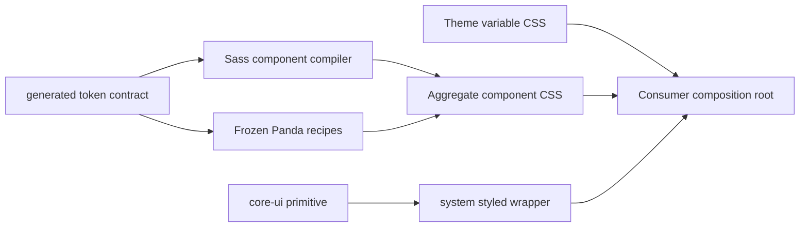

---
doc_meta:
  id: TDD-ui-platform-styled-004
  title: Styled Components and CSS Delivery
  owner: UI Platform Team
  version: 1.0.0
  status: approved
  classification: public
  parent_sad: SAD-003
  review_cycle_days: 30
  created_date: 2026-09-28
  last_reviewed: 2026-10-25
---

# TDD-ui-platform-styled-004: Styled Components and CSS Delivery

## Purpose

Define the exact seam between headless behavior, styled wrappers, token usage,
theme variables, cascade ownership, and the static CSS a consumer loads. The
design must render correctly from packed artifacts without consumer-side Panda
execution or implicit JavaScript side effects.

## Scope

In scope: `@scnx/system` styled entries, Sass component rules, the frozen Panda
recipe set, aggregate component CSS, theme CSS composition, cascade layers,
selector scoping, portal styling, forced-colors behavior, and packed-consumer
verification. Primitive state logic and token generation are owned by their
respective TDDs. Per-component CSS exports and Shadow DOM are outside v1.

## Technical Context

The baseline combines Sass and Panda, but JS import does not prove CSS delivery;
theme bundles may omit component rules; some rules sit outside declared layers;
and global `:root`/reset selectors can leak across co-located brands/remotes.

| ID      | Contract                                                                                                                     |
| :------ | :--------------------------------------------------------------------------------------------------------------------------- |
| STY-001 | Every styled component composes a public primitive and adds no independent behavior state machine.                           |
| STY-002 | Stable declarations consume Tier-2 tokens or justified Tier-3 aliases; raw-value exceptions are linted.                      |
| STY-003 | One aggregate component asset and one instance of each selected theme asset are loaded by the composition root exactly once. |
| STY-004 | Component JS has no CSS side-effect import; remotes never inject UI Platform CSS.                                            |
| STY-005 | All public rules participate in the canonical layer order and remain under an allowed scope.                                 |
| STY-006 | Portaled UI remains inside the originating theme root.                                                                       |
| STY-007 | Dual Sass/Panda ownership continues only if correctness, security, accessibility, and approved scenario budgets pass.        |

## Component Design



| Module                | Owns                                                                  | Prohibited                                           |
| :-------------------- | :-------------------------------------------------------------------- | :--------------------------------------------------- |
| styled wrapper        | visual variant props, primitive composition, stable parts/state hooks | duplicating focus/keyboard/state logic               |
| Sass component source | skinned component declarations                                        | global unlayered reset or raw Tier-1 consumption     |
| Panda adapter         | existing structural recipes only during P0                            | expanding recipe surface before dual-engine decision |
| CSS assembler         | deterministic layers and asset order                                  | source-order dependence outside layers               |
| consumer root         | importing component/theme assets once                                 | remote/component-level reinjection                   |

Canonical layer order is `reset, tokens, base, components, recipes, utilities,
overrides`. Layers determine priority;
`[data-scnx-theme][data-scnx-resolved-mode]` and component roots provide
isolation.

## Data Model

```ts
type StyledComponentRecord = {
  publicEntry: string;
  primitiveEntry: string;
  rootPart: string;
  parts: string[];
  states: string[];
  variants: Record<string, string[]>;
  tokenReferences: string[];
  tier3Aliases: Array<{ token: string; justification: string }>;
  cssOwner: "sass" | "panda";
  cssArtifact: "styles/components.css";
  themeCoverage: string[];
  stability: "candidate" | "stable";
};
```

The generated style manifest maps every stable component/part/state/variant to
its owner and artifact. Duplicate ownership of the same public selector/property
pair is rejected unless an explicit layer-ordered override is recorded.

## API / Interface

Public styling consists of:

- documented component props and visual variants;
- stable `data-part`, `data-state`, and accessibility-derived selectors;
- `[data-scnx-theme="<theme-id>"][data-scnx-resolved-mode="<mode>"]` roots;
- `@scnx/system/styles/components.css`;
- `@scnx/system/tokens/css/<theme-id>.css`; and
- documented token variables.

Private Sass class structure and generated Panda class names are not public.
Consumers may override through the final `overrides` layer and documented
tokens/parts only. A single-brand `:root` compatibility asset, which
ADR-UIP-PLT-001 permits, is not shipped in v1; a single-brand document passes
`root={document.documentElement}` to `ThemeProvider` instead, which puts the
theme attributes on `html`.

## Algorithms / Logic

### Compile and assemble

1. Load the validated normalized token contract.
2. Compile Sass components into the `components` layer.
3. Build only the frozen Panda recipe inventory into the `recipes` layer.
4. Parse both outputs and reject undeclared layers, selectors outside allowed
   scopes, undefined variables, raw-value violations, and duplicate ownership.
5. Assemble deterministic aggregate CSS in canonical layer order.
6. Pack CSS independently from JavaScript.
7. Install tarballs and import component plus selected theme CSS once at the
   composition root.
8. Render the supported set and assert computed properties and isolation.

#### Decision record: governed values in component CSS

STD-GLB-FE-005 section 3.2: "Governed shared decisions for color, typography,
spacing rhythm, radius, shadow, z-index, and motion use Tier-2 semantic tokens
or justified Tier-3 aliases", while "local geometry with no reusable semantic
role" stays valid and "records its purpose when the reason is not
self-evident". On 2026-10-21 the stylesheet gate (step 4) enforced only color,
`z-index`, custom properties, and `!important`; twelve motion declarations and
one radius in Accordion, CodeShowcase, and CodeSelect used literals (GV1–GV3),
and spacing and typography were not checked at all (GV4–GV7).

| ID  | Decision                                                                                                                                                                                                                                                                                                                                                                                                                                                                                                                                                                                                                                                                                                                                                                                                           | Source                                                              | Tradeoff                                                                                                                                                                                                                                                          |
| :-- | :----------------------------------------------------------------------------------------------------------------------------------------------------------------------------------------------------------------------------------------------------------------------------------------------------------------------------------------------------------------------------------------------------------------------------------------------------------------------------------------------------------------------------------------------------------------------------------------------------------------------------------------------------------------------------------------------------------------------------------------------------------------------------------------------------------------- | :------------------------------------------------------------------ | :---------------------------------------------------------------------------------------------------------------------------------------------------------------------------------------------------------------------------------------------------------------- |
| GV1 | The gate rejects a motion literal, meaning a duration, a timing keyword, or a timing function in a `transition` or `animation` property, and a non-zero length in a border radius, unless `styles.config.json` records an exception with its standard, reason, and removal condition. Zero durations and percentages are geometry and pass.                                                                                                                                                                                                                                                                                                                                                                                                                                                                        | STD-GLB-FE-005 3.2                                                  | The rule reads the built CSS, so a literal hidden behind a Sass variable that resolves to a literal is still caught.                                                                                                                                              |
| GV2 | A duration inside a `calc()` that multiplies a documented runtime property is a stagger step, a local value whose purpose the runtime property's entry records (`--item-index`, `--ancestors-index`: the Sidebar's 33 ms step).                                                                                                                                                                                                                                                                                                                                                                                                                                                                                                                                                                                    | STD-GLB-FE-005 3.2 ("local geometry"; "records its purpose")        | The step is not a token, because it has no reusable semantic role; a second component that staggers would make it one.                                                                                                                                            |
| GV3 | Each literal maps to the motion action the STD defines for it: height and opacity of expanding content and the rotating chevron of a disclosure use `motion.disclosure` ("Height expand/collapse for accordions, menus, and detail triggers"); hover, focus, and selection color, shadow, and indicator changes use `motion.feedback` ("State feedback on the same element"). `transition: all` becomes the properties that change. The scrollbar thumb radius uses `dimension.radius.element`.                                                                                                                                                                                                                                                                                                                    | STD-UIP-TKN-001, "Semantic Motion Language"                         | Feedback becomes 150 ms instead of 200 ms, and the Accordion chevron takes the disclosure curve instead of `cubic-bezier(0.16, 1, 0.3, 1)`; the thumb radius becomes 0.25rem instead of 3px. Static snapshots do not change, except possibly the scrollbar thumb. |
| GV4 | The gate also rejects a non-zero length in a spacing or positioning property (`padding*`, `margin*`, `inset*`, `gap`, `row-gap`, `column-gap`, `top`, `right`, `bottom`, `left`) and a non-zero length or number in `font-size`, `line-height`, `letter-spacing`, or `font-weight`, unless a recorded exception allows it. On 2026-10-21 it found 39 such literals, including the reference slice (Button, TextField, Tabs), not the 17 an earlier search had counted.                                                                                                                                                                                                                                                                                                                                             | STD-GLB-FE-005 3.2; STD-UIP-STY-001 2.1.0, "Governed values"        | Percentages, keywords, zero, and `var()` pass, so a value computed from tokens (for example `calc()` with a token) is not reported.                                                                                                                               |
| GV5 | Each literal maps by STD-UIP-STY-001's rule, the relationship first and then the nearest step, a tie taking the smaller step: Button padding `0.6rem 1.25rem` becomes inset compact and inset default; TextField `0.55rem 0.75rem` and CodeSelect `4px 10px` become inset compact; Tabs `0.55rem 0.9rem` becomes inset compact and inset default; Accordion's and the Sidebar header's `1.25rem` become inset default; FloatingLayout's region gap becomes `section` and its gutter and sticky offset become `page`; the CodeShowcase gaps and insets take inline, stack, and inset steps, and its navigation text takes the `label.default` role; the navigation group header's extra `0.05em` tracking is removed in favor of `label.small`'s; the code block's `0.925em` is removed in favor of `code.default`. | STD-UIP-STY-001 2.1.0, "Governed values"                            | A visual change, reviewed in Chromatic: for example Button becomes 35.5 px tall instead of 38.7, Tabs 35.5 instead of 37.1, TextField 42 instead of 43.6, and the FloatingLayout gap 2rem instead of 1.25rem.                                                     |
| GV6 | Eleven literals stay as recorded local geometry in `styles.config.json`, each with its purpose and removal condition: the EdgeLayout sticky offset (navbar height), the CodeSelect value's right clearance and the chevron glyph size, the Sidebar toggle's overhang, inline code's text-relative inset and size, the list-marker gutters, the CodeShowcase language-icon glyph size, and `line-height: 1` on the navigation icon and badge boxes.                                                                                                                                                                                                                                                                                                                                                                 | STD-UIP-STY-001 2.1.0 ("Record local geometry"); STD-GLB-FE-005 3.2 | Each is a candidate token if a second component needs the same geometry.                                                                                                                                                                                          |
| GV7 | The packed component fixture rejects a focusable part whose pointer target is below 24 by 24 CSS pixels (for CodeSelect, its wrapper). Before this change the TableOfContents link (21 px) and the CodeShowcase trigger (21 px) were below it; both get `min-block-size: 24px`, the trigger through a new class `scnx-code-showcase__trigger`.                                                                                                                                                                                                                                                                                                                                                                                                                                                                     | WCAG 2.2 SC 2.5.8 (STD-UIP-STY-001 [9])                             | 24 px is the criterion's own minimum, not a design value, so it is a literal outside the governed spacing properties. A larger padding would have met it too, but would have made each TableOfContents row 37 px tall.                                            |

#### Decision record: the Button recipe

The variant is the color axis of Button; the stroke is part of a variant's
recipe, not its meaning. On 2026-10-22 the recipe had three defects. The primary
label used `color.neutral.text.contrast.default`, the label of the _neutral_
solid fill, so in the dark default theme a primary Button computed a near-black
label (L 0.07) on blue, 2.6:1, below SC 1.4.3. No gate caught it: the token
gate tests each scheme's `contrast` on its own `solid`, and the story tests run
axe-core in light mode only. The secondary variant drew a neutral border, a stroke
the docs and product designs replace with a tonal fill. Disabled was
`opacity: 0.5` over the enabled colors, and the selector `[data-disabled="true"]`
never matched the empty `data-disabled` attribute that ButtonBase renders for a
disabled link or child.

| ID  | Decision                                                                                                                                                                                                                                                                                                                                   | Source                                                                                | Tradeoff                                                                                                                                                      |
| :-- | :----------------------------------------------------------------------------------------------------------------------------------------------------------------------------------------------------------------------------------------------------------------------------------------------------------------------------------------- | :------------------------------------------------------------------------------------ | :------------------------------------------------------------------------------------------------------------------------------------------------------------ |
| BR1 | Superseded by BI2 on 2026-10-25 (ADR-UIP-VIS-001 item 3). `primary` is the solid fill of the primary scheme with that scheme's `contrast` label in each state: `color.primary.surface.solid.{default,hover,pressed,disabled}` with `color.primary.text.contrast.{default,hover,default,disabled}`.                                                                                                   | STD-UIP-TKN-001, "Semantic Usage Doctrine" (`contrast` on `solid` of the same scheme) | The label now follows a theme that changes the primary scheme's polarity, as the achromatic theme does.                                                       |
| BR2 | Superseded by BI3 on 2026-10-25, except the transparent border, which BI1 keeps. `secondary` is tonal: `color.neutral.surface.default.{default,hover,pressed,disabled}` with `color.neutral.text.default.default`, and no visible stroke. Both variants keep a transparent border of `dimension.border-width.default`, so they are the same size and forced-colors mode, which removes backgrounds, still draws a boundary. | STD-GLB-FE-005 section 3.9 (forced colors); WCAG 2.2 SC 1.4.11                        | A Button's label identifies it, so SC 1.4.11 does not require the fill to reach 3:1 against the page; the light tonal fill is 1.1:1 on the canvas, by design. |
| BR3 | Disabled is carried by tokens at full opacity: the variant's `disabled` fill and label, on `:disabled` and on `[data-disabled]` (any value). Hover and pressed rules exclude both, so a disabled Button does not react.                                                                                                                    | STD-GLB-FE-005 section 3.2 (governed color decisions)                                 | Opacity composited the label over whatever lies behind the Button, so no pair could be measured; tokens make it measurable (TDD tokens SD1).                  |

The bindings of BR1–BR3 are recorded in `button.spec.json` and checked by the
specification gate and its browser fixture (CS1–CS6).

#### Decision record: recipe class namespace

The eight frozen Panda recipes (ADR-GLB-FE-013 5.3.2) emitted unprefixed
classes, `.container`, `.flex`, `.grid`, `.heading`, `.text`, `.code`, `.list`,
`.list-item`, and their variant classes, without a theme-root scope. A host
element with one of those common class names (Bootstrap's `.container`,
Tailwind's `.flex` and `.grid`) took UI Platform styles anywhere in the page.
The component fixture's host markup had none of those names, so host isolation
passed.

| ID  | Decision                                                                                                                                                                                                                                                                                                                                                                                        | Source                                                                                                       | Tradeoff                                                                                                                                                                                             |
| :-- | :---------------------------------------------------------------------------------------------------------------------------------------------------------------------------------------------------------------------------------------------------------------------------------------------------------------------------------------------------------------------------------------------- | :----------------------------------------------------------------------------------------------------------- | :--------------------------------------------------------------------------------------------------------------------------------------------------------------------------------------------------- |
| RN1 | Every recipe's `className` carries the `scnx-` namespace of the Sass components (`.scnx-heading`, `.scnx-heading--size_large`); the stylesheet gate accepts recipe selectors only in that namespace, and the component fixture's host markup carries the eight common names, with display, sizing, spacing, and font properties compared. The recipe inventory and its ownership are unchanged. | STD-UIP-STY-001 3, "Style Encapsulation in Federated Environments"; TDD styled, Testing Strategy "Isolation" | A published class-name change: a consumer selecting `.heading` must select `.scnx-heading`. Against `main`'s packages the extended fixture fails on the `.grid`, `.code`, and `.list` host elements. |

#### Decision record: styled specifications

How ADR-UIP-CMP-001 (accepted 2026-10-22) and STD-UIP-STY-001 2.2.0,
"Component specification", are implemented for `@scnx/system`. Styled specifications exist for the reference slice:
`button.spec.json`, `text-field.spec.json`, `dialog.spec.json`, and
`tabs.spec.json`, the recipe components `code`, `heading`, `text`, `container`, `flex`, and `grid`, and `divider`, `navbar`, `table-of-contents`, and `accordion`; every other styled component keeps its `entry` specification
(TDD primitives P23) until it gets one.

| ID   | Decision                                                                                                                                                                                                                                                                                                                                                                                                                                                                                                                                                                                                                                                                                                                                                                                                                                                                                                                                                                                                                                                             | Source                                                                                                                                                                                                                                                                                                                                                                                                                                                              | Tradeoff                                                                                                                                                                                                                                             |
| :--- | :------------------------------------------------------------------------------------------------------------------------------------------------------------------------------------------------------------------------------------------------------------------------------------------------------------------------------------------------------------------------------------------------------------------------------------------------------------------------------------------------------------------------------------------------------------------------------------------------------------------------------------------------------------------------------------------------------------------------------------------------------------------------------------------------------------------------------------------------------------------------------------------------------------------------------------------------------------------------------------------------------------------------------------------------------------------- | :------------------------------------------------------------------------------------------------------------------------------------------------------------------------------------------------------------------------------------------------------------------------------------------------------------------------------------------------------------------------------------------------------------------------------------------------------------------ | :--------------------------------------------------------------------------------------------------------------------------------------------------------------------------------------------------------------------------------------------------- |
| CS1  | A `styled` specification (`scripts/specs/schema/styled.schema.json`) names its primitive, its anatomy (each part's class selector and the primitive part it styles), its options (values, default, and the selector fragment that selects a value, for example `[data-variant={value}]`), its states (selector fragments and how each is entered: props, or the pointer for `hover` and `press`), the fixture props, and its bindings: for each part, option value, and state, every token-bearing declaration, written as the declared value with each token as `{token.path}`.                                                                                                                                                                                                                                                                                                                                                                                                                                                                                     | ADR-UIP-CMP-001 item 1 (vocabulary of Spectrum's component format, ADR-UIP-CMP-001 [R2])                                                                                                                                                                                                                                                                                                                                                                            | The template keeps the declared value whole (`padding: {a} {b}`, `border: {w} solid transparent`), so the specification reads like the stylesheet and needs no shorthand model; literal declarations stay governed by the stylesheet gate (GV1–GV7). |
| CS2  | The gate (`scripts/specs/inventory.mjs`, after the build) parses the published aggregate stylesheet and maps each rule of the component to a part, option values, and state from its selector; a selector it cannot map fails, and a state whose rules omit one of its selector alternatives fails. The effective token-bearing declarations of each rule (the last declaration of a property wins) must equal the bindings of the same identity, both ways.                                                                                                                                                                                                                                                                                                                                                                                                                                                                                                                                                                                                         | ADR-UIP-CMP-001 item 4                                                                                                                                                                                                                                                                                                                                                                                                                                              | A declaration overridden in the same rule is not a binding: Button's `@include typography(label, default)` emits a `font-weight` that `typography.weight.semibold` replaces, and only the latter is bound.                                           |
| CS3  | Each option's values equal the string-literal union of the same prop in the component's public-API report; every bound token exists in the token stylesheets; every part's `primitivePart` exists in the primitive specification; one binding per identity; a property set by both an option-only and a state-only binding of one part fails, because their order would depend on source position.                                                                                                                                                                                                                                                                                                                                                                                                                                                                                                                                                                                                                                                                   | ADR-UIP-CMP-001 item 4                                                                                                                                                                                                                                                                                                                                                                                                                                              | The API report is the published declaration, so a union change and a stylesheet change cannot drift apart unnoticed.                                                                                                                                 |
| CS4  | `scripts/browser-specs.mjs` installs the packed tarballs, server-renders every styled component once per theme root, option combination, and prop-entered state, and in every engine of the support matrix enters each pointer state with Playwright (`hover`, then `mouse.down` for `press`), waits for the element's transitions (`getAnimations()`), and requires each bound longhand to compute what the merged declaration templates compute on a probe in the same root, and an unbound `opacity` to compute 1. The merge order is rest, state, option, option and state.                                                                                                                                                                                                                                                                                                                                                                                                                                                                                      | ADR-UIP-CMP-001 item 5                                                                                                                                                                                                                                                                                                                                                                                                                                              | It replaces the Button-only recipe check of BR1–BR3 in the component fixture. Run against the packages of `main` before BR1–BR3, it fails on the dark primary label, the disabled fills, and the opacity, in all four roots.                         |
| CS5  | Each part's bound `color` on its bound `background` or `background-color`, per option combination and non-disabled state, is a token-gate contrast case at the text minimum in every theme and mode (`rendered-by-component`, TDD tokens).                                                                                                                                                                                                                                                                                                                                                                                                                                                                                                                                                                                                                                                                                                                                                                                                                           | ADR-UIP-CMP-001 item 6; WCAG 2.2 SC 1.4.3                                                                                                                                                                                                                                                                                                                                                                                                                           | Button adds 24 cases (two variants, three states, four theme modes). Reverting the primary label to the neutral contrast token fails at 2.59:1 (rest) and 1.87:1 (pressed) in the dark default theme.                                                |
| CS6  | The BR1–BR3 rows keep their rationale; their bindings live in `button.spec.json`, and a binding change is made there with the stylesheet.                                                                                                                                                                                                                                                                                                                                                                                                                                                                                                                                                                                                                                                                                                                                                                                                                                                                                                                            | ADR-UIP-CMP-001 item 10                                                                                                                                                                                                                                                                                                                                                                                                                                             | Rationale stays reviewable as prose while the facts are checked.                                                                                                                                                                                     |
| CS7  | A part's selector is the root's class followed by a combinator and simple selectors, or a pseudo-element (`.scnx-text-field > [data-part=input]`, `.scnx-dialog::backdrop`); options and `on: "root"` states attach to the root's class, other states to their part. A state is entered by props, by the pointer, or by the fixture tree already rendering it (`fixture: true`, for example a selected and a disabled tab). A fixture is the component's props or a node tree of its exports and sub-components (`Tabs.List`); `activate: "showModal"` opens a native dialog for its measurement and closes it after. The browser check measures each identity on the first element that matches its selector and no other part-level state, and fails when a bound part is never rendered.                                                                                                                                                                                                                                                                          | ADR-UIP-CMP-001 items 1 and 5                                                                                                                                                                                                                                                                                                                                                                                                                                       | A combination of two part-level states (a selected tab under the pointer) is not measured; each state is measured alone.                                                                                                                             |
| CS8  | The bindings in force for an identity are merged in cascade order: by the Selectors Level 4 specificity of their stylesheet selector, then by their order in the specification, a repeated property moving to the end so a later shorthand resets an earlier longhand. Bindings of one part with equal specificity whose properties overlap (`border-bottom`, `border-bottom-color`) must keep the stylesheet's order, which source order decides; this replaces CS3's option-state ambiguity rule. A literal declaration of a property the part binds to a token elsewhere is part of the bindings (`border-bottom: 0` in a vertical tab list).                                                                                                                                                                                                                                                                                                                                                                                                                     | W3C Selectors Level 4, section 17, "Calculating a selector's specificity"; ADR-UIP-CMP-001 item 4                                                                                                                                                                                                                                                                                                                                                                   | The first merge by option and state rank disagreed with the cascade on vertical selected tabs: the vertical rule's `border-bottom: 0` follows the selected rule and resets its indicator color.                                                      |
| CS9  | A bound border width must draw: when a binding sets a side's width from a `dimension.border-width` token, the element's computed style of that side may not be `none`. The probe takes the element's computed border and outline styles, so a width is compared in the element's own context.                                                                                                                                                                                                                                                                                                                                                                                                                                                                                                                                                                                                                                                                                                                                                                        | ADR-UIP-CMP-001 item 5                                                                                                                                                                                                                                                                                                                                                                                                                                              | Code declared a border width and color with no style, and the reset sets none, so its intended border never drew; against the packages before this change the check fails on every Code case.                                                        |
| CS10 | Panda recipes are specified like Sass components: an option whose selector starts with a period is a class on the root (`.scnx-heading--size_{value}`), and a stylesheet rule written with that class alone selects the root. Specificity is taken from the stylesheet form. A default may be null (no class when the prop is absent). A boolean option has the values `false` and `true` and the fixture passes the boolean. Options vary one at a time from their defaults, and jointly only where one binding names several. Option unions are read from the public-API report, the primitive's report, and the published declarations of the entry and the chunks it imports, because the reports omit unions declared in an unexported type (Heading's `HeadingVariants`). Bound tokens are canonical names of the token output (`dimension.spacing.inset-compact`, not a dotted spelling of its custom property). A class that only extends the root's name with one hyphen is another component (`.scnx-code-select` is not `.scnx-code`'s).                  | ADR-UIP-CMP-001 items 1 and 4                                                                                                                                                                                                                                                                                                                                                                                                                                       | Flex's five options give 19 cases instead of 1,800. The report gap is recorded, not fixed here: a union change in those components is visible in the published declarations and the specification gate, not in the API report.                       |
| CS11 | Text's `dimmed` is carried by `color.neutral.text.subtle.default` alone; its `opacity: 0.7` faded the text below its measured contrast and is removed (CS4).                                                                                                                                                                                                                                                                                                                                                                                                                                                                                                                                                                                                                                                                                                                                                                                                                                                                                                         | STD-GLB-FE-005 3.2; WCAG 2.2 SC 1.4.3                                                                                                                                                                                                                                                                                                                                                                                                                               | A visual change: dimmed text keeps its color and loses the extra fade.                                                                                                                                                                               |
| CS12 | A part's selector is one or more compounds: a BEM element (`.scnx-accordion__item`), the root and a combinator (`.scnx-tabs [data-part=tab]`), or another part and a combinator (`.scnx-toc__item .scnx-toc__list`), which may `extends` that part to take its bindings. A rule belongs to the component its first compound starts at: `.scnx-edge-layout__header .scnx-navbar` is EdgeLayout's rule, and a rule whose context is the root (with options or root states) or another part (with a state `on: <part>`, `.scnx-accordion__trigger[data-state=open] .scnx-accordion__icon`) is described from that context. A state may be entered by focus (`focus`, `focus-within`) or by an attribute the fixture sets for a state the primitive sets at run time (a table of contents marks the section in view). The check measures a state only on the parts it binds, enters a state on another part's element when the state is `on` that part, and fails when a bound state is never measured, so a fixture that cannot reach a state is a failure, not a skip. | ADR-UIP-CMP-001 items 1, 4, and 5                                                                                                                                                                                                                                                                                                                                                                                                                                   | Rules that reach into another component's internals (Sidebar, EdgeLayout) are described as that component's own; their specifications wait for the encapsulation change (CS13).                                                                      |
| CS13 | Divider, Navbar, TableOfContents, and Accordion get `styled` specifications, and the review fixes what they exposed: Divider's public `color` union is `default`, `muted`, `primary`, but `primary` had no rule and drew the default color while a `strong` rule no prop reached existed; `primary` now takes `color.primary.border.default.default`, and the unreachable `strong` color and weight rules are removed. Accordion's `--stacked` modifier class was reachable only by hand; Accordion takes `variant: "separated"                                                                                                                                                                                                                                                                                                                                                                                                                                                                                                                                      | "stacked"`, rendered as `data-variant`. Literal `1px`border widths in Navbar, Accordion, CodeShowcase, CodeSelect, Sidebar, and EdgeLayout take`dimension.border-width.default` (1px in every theme). Sidebar's and EdgeLayout's selectors into Navigation, Transition, and Navbar internals (`.scnx-sidebar__flyout > .scnx-transition > div > div > .scnx-navigation__group`) are not specified until those components expose the parts or options Sidebar needs. | STD-UIP-STY-001 3; STD-UIP-PRM-001 (public props)                                                                                                                                                                                                    | A Divider with `color="primary"` changes from the default to the primary border color; the stacked accordion is now a prop. The thin weight's 0.5px height stays a literal, recorded as a rendering risk on 1x displays. |
| CS14 | A `styled` specification may record its component geometry in `geometry`: the literal size declarations (`block-size`, `inline-size`, `height`, `width`, their `min-` and `max-` forms, and `aspect-ratio`) by part, option value, and state, in the binding form. A specification that has `geometry` records all of them, and the gate compares both directions, as it does for bindings; a token in a geometry value is a finding, because a token-bound size is a binding. The field is optional, so each component adopts it when its specification moves to the identity (PLAN I2); IconButton records its `aspect-ratio: 1` first. | ADR-UIP-VIS-001 item 6 (each component's specification records control heights, row heights, and icon sizes); STD-UIP-TKN-001, "Values that are not Tier-2 tokens" | Optional adoption leaves the 72 size literals of other components unchecked until their I2 change; requiring all at once would change specifications outside the plan's order. Layout values (`100%`, `auto`, `0`) are recorded too once a component adopts the field, which keeps the rule simple at the cost of a few entries. |
| CS15 | A part may be a pseudo-element of an element part (`.scnx-tabs [data-part=tab]::before`). Its states and options are written before the pseudo-element, as CSS requires (`[data-part=tab]:hover:not(:disabled)::before`), both when a selector is built and when a stylesheet rule is mapped to a binding; the browser fixture measures the pseudo-element's computed style on its host. | CSS Selectors Level 4, pseudo-elements; ADR-UIP-CMP-001 item 4 | Without it, a hover or selected rule on a pseudo-element read as undescribed, so a component drawing an indicator or a pill in a pseudo-element could not be specified. Four self-test cases pin the order and an undescribed state. |

#### Decision record: Badge, Alert, and IconButton

The first P1 components (PLAN "Later work"). Each is born with its `styled`
specification (ADR-UIP-CMP-001 item 11), so its bindings, contrast (CS5), and
computed values in every theme root and engine (CS4) are gated from the first
commit. Minimum contrasts below are the lowest of the gate's four display
paths over both modes and every scheme, on the palette of TDD tokens PG1-PG11.

| ID  | Decision | Sources | Tradeoff |
| :-- | :------- | :------ | :------- |
| BD1 | Badge composes BadgeBase (TDD primitives P25) with three options on its root: `scheme` (`neutral`, `primary`, `info`, `success`, `warning`, `danger`; default `neutral`), `emphasis` (`subtle`, `solid`; default `subtle`), and `size` (`small`, `medium`; default `medium`). | Radix Themes `badge.css` at radix-ui/themes `1faff10ac26ae17f09944d418c6949b93fc6b566` (`variant`, `color`, `size`); STD-UIP-TKN-001 scheme vocabulary | The color axis is named after the token scheme, not `color`, which would shadow the HTML attribute; Radix's `surface` and `outline` variants are left out until a consumer needs a bordered badge. |
| BD2 | `subtle` is the scheme's component fill, `surface.default` (step 3), under its low-contrast text, `text.subtle` (step 11), as Radix's soft badge takes `accent-a3` and `accent-a11`; `solid` is `surface.solid` under `text.contrast`, as Radix's solid badge takes `accent-9` and `accent-contrast`. Subtle pairs measure at least 5.22:1; solid pairs are PG3's and PG11's labels. | Radix Themes `badge.css`, same commit; TDD tokens PG3, PG4, PG11 | Opaque steps instead of Radix's alpha steps, so every pair is measured on its own fill rather than on whatever lies behind it (TDD tokens G3). |
| BD3 | The size takes the label typography (`label.default`, `label.small`) with inline padding only (`inline-default`, `inline-compact`); the radius is `dimension.radius.element` (`mark` for a small badge since RL1); a transparent border of `dimension.border-width.default` draws the boundary in forced-colors mode, as Button's does (BR2). | STD-GLB-FE-005 3.9; BR2 | The height follows the line height, so a badge sits on a text line without changing it. |
| BD4 | `dot` (default `false`) leads the label with a 6 px status dot, an `aria-hidden` `dot` part that Badge renders before its children, so BadgeBase is unchanged. The dot is `radius.pill` in `currentColor`: it takes the label's color and so its contrast, and its size is recorded geometry (CS14). The part is for a live status ("Live", "Failed"). | Design reference `components/Badge/README.md`; WCAG 2.2 SC 1.4.1 | The dot is decorative and the word names the status, so in forced-colors mode, which replaces backgrounds and can hide the dot, nothing is lost. |
| AL1 | Alert composes AlertBase (TDD primitives P26): a polite `status` region by default and `role="alert"` on request, with the `icon`, `title`, message, and `actions` parts. One option, `scheme` (`neutral`, `info`, `success`, `warning`, `danger`; default `info`). | TDD primitives P26 | `primary` is left out: an alert reports a state, and the brand color carries no state. |
| AL2 | The root takes the scheme's `surface.subtle` (step 2), `border.subtle` (step 6), and `text.subtle` (step 11) for the message; the title takes `text.default` (step 12) and `typography.weight.semibold`; the icon takes `icon.subtle`. This is Radix's surface callout (`accent-a2` fill, `accent-a6` border, `accent-a11` text). The message measures at least 5.48:1 on its fill and the title 10.67:1. | Radix Themes `callout.css`, same commit; TDD tokens PG4 | The title and the icon are bound on parts without a fill, so CS5 measures the root's pair; PG4 constructs step 11 and 12 above 4.5:1 on steps 1-5 of their own scale, which covers both. |
| AL3 | The layout is one row: the icon, the content (a column with a `stack-compact` gap), and the actions, with an `inline-default` gap and `inset-default` padding, `body.small` typography, and the `container` radius. | STD-UIP-STY-001 2.1.0, "Governed values" | A long action row wraps under the message only when the consumer gives the actions their own layout; the part does not wrap by itself. Actions are Buttons or IconButtons, which meet the 24 px target (GV7); the component fixture's first run with a plain text link there failed SC 2.5.8 at 21 px, so a bare link in actions is the consumer's target decision. |
| IB1 | IconButton composes ButtonBase in all three of its modes (button, link, `asChild`). Its type requires exactly one of `aria-label` and `aria-labelledby`, as Primer's IconButton does, so an unnamed icon button does not compile; a type test pins both failures. | Primer `packages/react/src/Button/types.ts` at primer/react `3a71047af6337f403c556ba6ee726b334cfbff6c` (`ButtonA11yProps`); WCAG 2.2 SC 4.1.2 | A runtime check would only warn; the type stops the defect before review. A consumer naming it through a tooltip still names it through `aria-labelledby`. |
| IB2 | Superseded by BI4 on 2026-10-25, except the ghost icon colors, which BI4 keeps. `variant` takes `primary`, `secondary` (default), or `ghost`. `primary` and `secondary` are Button's rules, emitted by one Sass mixin (`styles/abstracts/_button.scss`), so the two components cannot drift; Button's compiled CSS is byte-identical. `ghost` has no fill at rest under `neutral.icon.subtle` (step 11, at least 5.80:1 on the canvas), and takes `neutral.surface.subtle` hover and pressed (steps 3 and 4) under `neutral.icon.subtle.hover` (step 12, at least 12.41:1), as Radix's ghost button takes `accent-a3` on hover. | Radix Themes `_internal/base-button.css`, same commit; BR1-BR3 | A ghost's rest state has no fill to pair with, so its icon is measured by PG4 against the neutral surfaces instead of by CS5. |
| IB3 | Superseded by BI5 on 2026-10-25. `size` is `small` (24 px square, padding `inline-compact`) or `medium` (default, 32 px, padding `inline-default`) around a 16 px icon, with `aspect-ratio: 1`. | WCAG 2.2 SC 2.5.8; GV7 | `small` is the criterion's minimum, so it never shrinks below it; a smaller icon button needs the spacing exception of SC 2.5.8, which the component cannot prove. |

#### Decision record: Button and IconButton identity

PLAN I2 moves Button and IconButton to ADR-UIP-VIS-001; the visual target is
the design reference's `components/Button/` and `components/IconButton/`
(ADR-UIP-VIS-002). Both components share one Sass mixin, so they change
together. After the change the token gate measures 2720 contrast cases,
including every variant's pairs in both themes and modes, with zero findings.

| ID  | Decision | Sources | Tradeoff |
| :-- | :------- | :------ | :------- |
| BI1 | Size is the geometry axis: `small` 28 px, `medium` (default) 36 px, `large` 44 px, recorded in each specification's `geometry` (CS14). Small takes the `element` radius, medium and large `control`. A Button's inline padding is half its height minus 6 px, the control spacing of its size (STD-UIP-TKN-001 2.5.0; TDD tokens SI6): `control-compact` 8 px, `control-default` 12 px, `control-comfortable` 16 px. Until 2026-10-25 medium's 12 px was recorded local geometry in `styles.config.json`, because no spacing step was 12 px. Small takes `label.small` and a compact gap; large takes the `body.default` size. Every variant keeps BR2's transparent border for forced-colors mode. | ADR-UIP-VIS-001 items 2 and 6; STD-UIP-STY-001 3 (local geometry); STD-GLB-FE-005 3.9 | A fixed height replaces padding plus line height, so a Button no longer grows with its font. The 12 px step waited for a second component; TextField was it, and the owner chose the token on 2026-10-25. |
| BI2 | `primary` is ink: `color.neutral.surface.solid.{default,hover,pressed,disabled}` under `color.neutral.text.contrast.{default,hover,default,disabled}`. The hover shadow is removed. The primary scheme no longer fills a button. | ADR-UIP-VIS-001 item 3 ("ink acts, blue signals") | Every primary Button changes from blue to black in light mode and white in dark mode; a brand theme that wants a brand-filled action needs the open question below answered first. Ink is the same in every theme, so the packed component fixture's coexistence check now tells the themes apart by the primary Button's corner radius (12 px `control` in default, 8 px in achromatic) instead of its fill. |
| BI3 | `secondary` is the `raised` material: `color.neutral.surface.raised.default` with `effect.material.raised` (ring, contact, and ambient shadow). Hover and pressed take `neutral.surface.subtle` (steps 3 and 4); pressed sinks to `effect.material.flat`, the ring alone; disabled keeps the flat ring on the disabled fill. The design reference's hand-made stroke and contact shadow are not used. | ADR-UIP-VIS-001 item 1 (components use a material, never a hand-made border and shadow); WCAG 2.2 SC 1.4.11 | The ring is `border.subtle`, below 3:1 on the canvas; a Button's label identifies it, so SC 1.4.11 does not require its boundary to (as BR2 recorded). The reference card is regenerated from the package in PLAN I6. |
| BI4 | `ghost` has no fill at rest under `neutral.text.default` (IconButton keeps IB2's `neutral.icon.subtle` colors) and takes `neutral.surface.subtle` on hover and pressed. `danger` is the danger solid under its contrast label, `color.danger.surface.solid.*` with `color.danger.text.contrast.*`, for the confirming action of something destructive. Both components take all four variants from one mixin. | ADR-UIP-VIS-001 item 3; Radix Themes `_internal/base-button.css` (ghost) | A ghost's rest state has no fill to pair with, so CS5 measures its hover and pressed pairs only. |
| BI5 | IconButton is a square of Button's heights, 28, 36, and 44 px, with zero padding, so an IconButton and a Button of one size align in a row. Small stays above the 24 px minimum of SC 2.5.8. | ADR-UIP-VIS-001 item 6; WCAG 2.2 SC 2.5.8; GV7 | Squares grow from 24 and 32 px; an icon passed by the consumer is still 16 px, so the icon has more room. |
| BI6 | A pressed control moves 1 px into the page (`translate: 0 1px`) unless reduced motion is requested. | Design reference `components/Button/README.md`; WCAG 2.2 SC 2.3.3 | The move is a transition on `translate`, which the feedback motion tokens time; under `prefers-reduced-motion: reduce` the control only changes color. |

#### Decision record: TextField identity

PLAN I2 moves TextField to ADR-UIP-VIS-001; the visual target is the design
reference's `components/TextField/` (ADR-UIP-VIS-002). The label,
description, error typography, and colors are unchanged.

| ID  | Decision | Sources | Tradeoff |
| :-- | :------- | :------ | :------- |
| TF1 | The input is a medium control: at least 36 px tall (`min-block-size`, recorded in the specification's `geometry`, CS14) with no block padding and a medium Button's inline padding, `dimension.spacing.control-default` (12 px; STD-UIP-TKN-001 2.5.0). The radius stays `control`. A TextField and a medium Button align in one row. | ADR-UIP-VIS-001 items 2 and 6; BI1; STD-UIP-TKN-001 2.5.0 (TDD tokens SI6) | A minimum, not a fixed height, so text zoom still grows the input instead of clipping it. TextField was the second component to need 12 px, the point BI1 set to reconsider a spacing step; the `control` relationship replaced both components' exceptions. |
| TF2 | Focus is a signal, so it is blue: on `:focus-visible` the border takes `color.primary.border.default.focus`, the color of the focus outline, and the outline sits flush (`outline-offset: 0`) instead of 2 px outside. An invalid field keeps its danger border while focused, under the blue outline. | ADR-UIP-VIS-001 item 3; STD-GLB-FE-005 3.9 | The outline still carries focus in forced-colors mode, where the border color is replaced; the border change only adds emphasis. |
| TF3 | The error line leads with a 16 px icon (a crossed circle in `currentColor`), laid out as a row with an `inline-compact` gap. The styled component adds it to the `error` it passes to TextFieldBase, so the primitive is unchanged. The icon is `aria-hidden` and not focusable, so the accessible description is the message alone. | Design reference `components/TextField/README.md`; WCAG 2.2 SC 1.4.1 | The icon is a second visual cue beside the danger color; a consumer who passes an icon in `error` gets two, so the documented contract is a text message. |

#### Decision record: radius ladder adoption

PLAN I2 for the components whose only delta in the design reference is a
radius (ADR-UIP-VIS-001 item 2; cards `components/Badge/`, `Code/`, `Alert/`).
Badge's new `dot` part is a separate change, because it adds anatomy and API (BD4).

| ID  | Decision | Sources | Tradeoff |
| :-- | :------- | :------ | :------- |
| RL1 | A medium Badge keeps `dimension.radius.element` (8 px since #110); a small Badge takes `dimension.radius.mark` (4 px), so a badge inside a dense row is not rounder than its row. | ADR-UIP-VIS-001 item 2; STD-UIP-TKN-001 2.4.0; design reference `components/Badge/README.md` | Two radii for one component; the size option already changes its typography and padding, so the radius follows the same axis. |
| RL2 | Inline code (the `code` recipe) moves from `element` to `mark` (4 px), so the 4 to 8 px change of `element` in #110 does not round inline code in running text. | ADR-UIP-VIS-001 item 2; design reference `components/Code/README.md` | Code in a heading and code in body text keep one radius; its em-based padding still scales with the text (GV4 exception). |
| RL3 | Alert already binds `dimension.radius.container`, which became 16 px in #110; its card's delta is met without a change, and the specification conformance fixture computes 16 px (12 px achromatic) in every root. | ADR-UIP-VIS-001 item 2; TDD tokens SI1 | None: the token carried the change, which is the point of binding the radius by intent. |

#### Decision record: Dialog material

PLAN I2 moves Dialog onto its material; the visual target is the design
reference's `components/Dialog/` (ADR-UIP-VIS-002).

| ID  | Decision | Sources | Tradeoff |
| :-- | :------- | :------ | :------- |
| DG1 | The dialog is the modal material: `color.neutral.surface.floating.default` with `effect.material.modal` and `dimension.radius.panel` (24 px default, 20 px achromatic). Its subtle border and `effect.shadow.overlay` are removed, because the material's ring is its edge; a transparent border of `dimension.border-width.default` stays, as Button's does (BR2). The scrim is `color.neutral.shadow.strong.default` itself, not a `color-mix()` of it. | ADR-UIP-VIS-001 items 1 and 2; STD-UIP-TKN-001 2.4.0 "Effect contract" | The scrim is darker than the 55 % mix it replaces; a token-valued scrim lets a theme set it without a component change. In forced-colors mode, which removes the ring and shadows, the transparent border draws the dialog's boundary. |
| DG2 | Two layout parts: `Dialog.Body` (`data-part="body"`, `stack-comfortable` below it) and `Dialog.Actions` (`data-part="actions"`, a wrapping row at the end edge with an `inline-default` gap; dismiss first, the confirming action last). Both are plain `<div>`s; DialogBase is unchanged. | Design reference `components/Dialog/README.md` | A consumer may still place `Dialog.Close` directly in the dialog; it then flows as before instead of joining the actions row. |
| DG3 | `Dialog.CloseButton` is the corner close: DialogBase's `Close` styled as a small ghost IconButton, with an `aria-hidden` cross, the accessible name "Close" unless `aria-label` overrides it, and `data-corner`, which places it `inset-default` from the top-end corner. The title reserves `inset-comfortable` at its end, so a long title wraps before the button. | Design reference `components/Dialog/README.md`; WCAG 2.2 SC 2.5.8, 4.1.2 | The corner is selected by `data-corner`, not by `data-part="close"` alone, because DialogBase gives every close control that part; selecting the part alone would move a consumer's text Close into the corner. |

#### Decision record: Tabs identity

PLAN I2 moves Tabs to ADR-UIP-VIS-001; the visual target is the design
reference's `components/Tabs/` (ADR-UIP-VIS-002).

| ID  | Decision | Sources | Tradeoff |
| :-- | :------- | :------ | :------- |
| TB1 | A tab is a medium control: at least 36 px tall (geometry, CS14) with `control-default` inline padding and no block padding, its label and an optional count laid out in a row with an `inline-default` gap. A count is a small Badge. | ADR-UIP-VIS-001 item 6; STD-UIP-TKN-001 2.5.0; design reference `components/Tabs/README.md` | Tabs align with Buttons and TextFields of the same size; the tab no longer grows with its padding. |
| TB2 | Hover is a pill behind the label: the tab's `::before`, inset `stack-compact` from the top and bottom of the row, `radius.element`, filled with `neutral.surface.subtle.hover`. It is painted behind the label with `z-index: -1` inside the tab's own stacking context (`isolation: isolate`), a recorded exception, because it orders paint within one tab and is not a page layer. | Design reference `components/Tabs/README.md`; STD-UIP-STY-001 3 | The full-height hover fill is gone; the pill reads as one control inside the row. |
| TB3 | The selection indicator is the tab's `::after`, inset to the label by `control-default`, `radius.pill`, drawn as a `border-width.strong` border in `primary.surface.solid` on the selected tab only (the inline end in a vertical list). A border survives forced-colors mode and only the selected tab has one, so the indicator still marks the selection there; the heavier weight remains a second cue. | ADR-UIP-VIS-001 item 3; STD-GLB-FE-005 3.9; WCAG 2.2 SC 1.4.1 | A background-drawn indicator would vanish in forced-colors mode; a transparent border on every tab would draw an underline under all of them there. |

#### Decision record: Accordion material

PLAN I2 moves Accordion onto its material; the visual target is the design
reference's `components/Accordion/` (ADR-UIP-VIS-002).

| ID  | Decision | Sources | Tradeoff |
| :-- | :------- | :------ | :------- |
| AC1 | A separated item is the flat material: `neutral.surface.raised` fill, `radius.container` (16 px since #110), and `effect.material.flat` (the ring) as its edge. Its default-colored border is removed; a transparent border of `border-width.default` keeps the boundary in forced-colors mode, as Button's does (BR2). In the stacked variant the group carries the material and clips its items, which are divided by a `border.subtle` line, the last item excepted. The content's own canvas fill is removed so the item is one surface, and the line above the content takes `border.subtle` too. | ADR-UIP-VIS-001 items 1 and 2 | The first and last items no longer round their own corners; the group's clip does it. Lines inside a material share the ring's color, so the item reads as one object. |
| AC2 | The trigger has no fill at rest and takes `neutral.surface.subtle.hover` on hover. | Design reference `components/Accordion/README.md`; ADR-UIP-VIS-001 item 3 | The tonal fill marked every trigger as a control; the label, the chevron, and the hover fill carry that now. |
| AC3 | Focus is the focus outline on the trigger, drawn inside it (`outline-offset: calc(-1 * border-width.strong)`) and rounded to `radius.container`, because the item clips everything outside its corners. The item's `:focus-within` border recolor and `effect.shadow.focus` are removed. | STD-GLB-FE-005 3.9; WCAG 2.2 SC 2.4.7, 2.4.13 | One focus indicator for the whole system; forced-colors mode keeps an outline, which the removed shadow was not. A script focus matches `:focus-visible` on a button only after keyboard input, and engines count it differently, so the conformance fixture presses Shift (Chromium), focuses with `focusVisible: true` (Firefox, WebKit), and otherwise moves focus by Tab from a sentinel placed before the part. |

### Portal and scope resolution

Overlay components receive a portal container from the active theme provider,
except a native `dialog` shown with `showModal()`, which stays inside the theme
root and renders in the top layer (TDD primitives P16).
The container is a descendant of the originating theme root. If no valid portal
container exists, a portal-dependent component fails with a development
diagnostic and remains outside Stable support; it does not silently mount under
unscoped `document.body`.

### Dual-engine eligibility

Measure both engines in the same packed scenario. If both pass all mandatory
gates and the approved scenario budgets, retain the bounded split. If one fails,
consolidate on the eligible engine through an ADR/TDD revision. If neither
passes, block Stable promotion. Measurements do not create universal policy.

## Configuration

The versioned style manifest declares stable components, CSS owner, public
parts/states, theme coverage, aggregate entry, canonical layers, allowed root
selectors, raw-value allowlist, and frozen Panda recipes. Configuration is build
input, validated against actual source and output, and cannot vary by runtime
environment.

## Failure Handling

| Failure                                   | Response                                                     |
| :---------------------------------------- | :----------------------------------------------------------- |
| Missing CSS for stable component/state    | Block package pair                                           |
| Undefined token or invalid computed value | Block affected theme/component                               |
| Undeclared/global selector leak           | Reject output before packing                                 |
| Duplicate stylesheet instance             | Fail consumer fixture; root/remote loading must be corrected |
| Portal outside theme root                 | Fail component scenario; no global fallback                  |
| Forced-colors focus loss                  | Block affected focusable component                           |
| Dual-engine budget/correctness failure    | Execute documented consolidation branch                      |

## Observability

The CSS report records source/artifact digests, rule/declaration counts by
layer and owner, undefined variables, raw-value exceptions, duplicate selector
pairs, asset bytes by encoding, computed-style failures, stylesheet instance
counts, and portal/scope failures. Visual diffs are retained as evidence but do
not replace computed-style and behavior assertions.

## Testing Strategy

- Static: token usage, allowed selectors, layer membership, ownership, raw-value
  exceptions, output parse, deterministic order.
- Unit: wrapper prop consumption, primitive delegation, variant/state-to-hook
  mapping, absence of behavior duplication.
- Packed browser: supported component/state matrix under every theme/mode,
  aggregate/theme path resolution, tree shaking, no JS CSS side effect.
- Isolation: two differently themed roots, nested root, portal, host plus two
  remotes in both load orders, and consumer override layer.
- Accessibility: visible `:focus-visible` outline, forced colors, contrast,
  reduced motion, disabled and selected states.
- Visual: stable reference scenarios across declared browsers and densities.
- Workshop (ADR-UIP-WKS-001): every supported component has Storybook stories
  for its documented variants and states. The preview loads the built
  `styles/components.css` and `tokens/css/<theme-id>.css`, never Sass or Panda
  source, and wraps each story in the ThemeProvider with a control for every
  theme ID and mode. Each story runs as a Vitest browser-mode test in Chromium
  with axe-core at `a11y.test: "error"`; a story downgraded to the warning
  level records the reason and its owner. Chromatic compares every story on each push and blocks merge on
  an unreviewed visual change.
- Negative: missing theme asset, duplicate component asset, global reset,
  unlayered rule, invalid variable, unauthorized Tier-1 value.

## Performance Notes

Measure aggregate and theme CSS bytes, unused declarations for the reference
slice, style recalculation, generated variant count, build duration, and
incremental consumer impact. Each result records browser, device/runner, build
mode, tool, baseline, and encoding. There is no universal 10% or 2x rule.

## Security Notes

Style generation is build-time and performs no runtime evaluation. Strict CSP
requires no `unsafe-inline`; static stylesheet loading follows consumer policy.
CSS input is repository-owned, and any future external theme input must be
validated as data rather than interpolated into selectors/declarations.

## Operational Notes

Runbooks cover missing styling, token resolution, leakage, duplicate assets,
visual regression, and rollback. A public selector/token/asset change requires
compatibility classification, migration notes, and a new immutable version.

## Rollout and Compatibility

First generate the style manifest from the current inventory, close all missing
and duplicate ownership, introduce canonical layers/scopes, assemble the
aggregate asset, and prove packed consumers. Then run the dual-engine decision
gate before Stable promotion. Baseline private class names receive no aliases;
documented parts and assets become the v1 compatibility boundary.

The baseline Sidebar read ten undocumented custom properties. STD-GLB-FE-005
section 3.2 prohibits them ("Custom properties in shared and application styles
are either `--ds-*` tokens or documented Tier-3 aliases; ad-hoc custom properties
are prohibited"), the style gate enforces it, and they were removed: `--sidebar-width`,
`--layout-sidebar-width`, `--sidebar-bg-color`, `--sidebar-group-header-color`,
`--sidebar-item-color`, `--sidebar-item-hover-bg`, `--sidebar-item-hover-color`,
`--sidebar-item-active-bg`, `--sidebar-item-active-color`, and
`--sidebar-item-active-weight`. They receive no aliases, like the private class
names. A consumer that set them overrides the Sidebar through the `overrides`
layer or a Tier-3 alias (STD-UIP-TKN-001, "Tier-3 Alias Governance"), and the
migration evidence of a pilot (PLAN P3) lists any such use.

## Open Questions

- Does the dual-engine gate retain both Sass and Panda after the reference slice?
- Which components, if any, need per-component CSS in a future major version?
- Is the single-brand `:root` compatibility asset required by a named consumer?
- Does a white-label brand theme need its primary action in the brand hue? ADR-UIP-VIS-001 item 3 keeps the primary action ink in every theme and reserves the primary scheme for focus, links, checked, progress, and location. If a named consumer requires a brand-filled action, the options are to keep the rule (the brand hue still carries every signal) or to add one theme-level switch (`ink` or `brand`) by a new ADR, at the cost of a second recipe tested in every component. Recorded 2026-10-24; nothing changes until a consumer asks.

## Traceability

Architecture authority: SAD-003; ADR-GLB-FE-013, ADR-UIP-PLT-001,
ADR-UIP-CMP-001, and proposed ADR-UIP-WKS-001;
STD-GLB-FE-003/005/008/009 and STD-UIP-STY-001/ENG-001. Lifecycle status in
`scnehaux-architecture` controls authority. Execution:
[PLAN](../../PLAN.md) P0 rows 5, 9–11 and the component workshop. Related designs: tokens, theme runtime,
primitives, and packaging.
