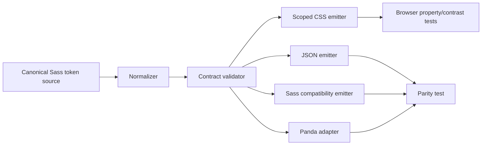

---
doc_meta:
  id: TDD-ui-platform-tokens-003
  title: Theme and Token Output
  owner: UI Platform Team
  version: 1.0.0
  status: approved
  classification: public
  parent_sad: SAD-003
  review_cycle_days: 30
  created_date: 2026-09-28
  last_reviewed: 2026-10-25
---

# TDD-ui-platform-tokens-003: Theme and Token Output

## Purpose

Define one deterministic token pipeline that implements the centrally governed
three-tier language and emits complete, type-correct, scoped, and equivalent
CSS, JSON, Sass, and Panda-facing contracts for every supported theme.

## Scope

In scope: core values, semantic mappings, justified component aliases, the
shipped themes (`scnx-platform`, the default, and `scnx-saas`), light/dark modes, font metadata, CSS custom properties,
stable `@scnx/system/tokens/*` entries, validation, migration, and release
evidence. DTCG interchange is a target output only after its generator passes
parity. Product tokens and component CSS rules are out of scope.

## Technical Context

Sass maps are the baseline source; the Tier-1 color maps are generated into one
Sass module (decision record "Palette generation"). The baseline has undefined Panda references,
malformed shadow serialization, unequal public shadow sets, legacy names, and
an invalid achromatic expression. OKLCH does not by itself prove contrast, and
alpha results depend on their actual backgrounds.

| ID      | Contract                                                                                 |
| :------ | :--------------------------------------------------------------------------------------- |
| TKN-001 | Every token has one canonical logical name, type, tier, and owner.                       |
| TKN-002 | Tier 2 never references Tier 3; Tier 3 resolves to Tier 2.                               |
| TKN-003 | Every supported theme/mode exposes the identical public Tier-2 key set and types.        |
| TKN-004 | CSS, JSON, Sass, and Panda outputs derive from one normalized dictionary and agree.      |
| TKN-005 | Every reference resolves; every substituted CSS value parses for its consuming property. |
| TKN-006 | Actual foreground/background and non-text pairs pass applicable WCAG 2.2 gates.          |
| TKN-007 | A focus shadow supplements but never replaces a visible outline.                         |
| TKN-008 | Generated artifacts are reproducible and never hand-edited.                              |

## Component Design



| Component          | Responsibility                                                                                            |
| :----------------- | :-------------------------------------------------------------------------------------------------------- |
| normalizer         | Convert source maps into ordered typed records; reject duplicate logical names                            |
| contract validator | Enforce central grammar, legal type, tier direction, references, theme coverage, and alias review records |
| emitters           | Serialize the same normalized record set into target formats                                              |
| browser verifier   | Load packed CSS and verify computed values, pairs, roots, and coexistence                                 |
| migration reporter | Map removed baseline names to canonical names and enumerate affected source callsites                     |

The canonical grammar remains owned by STD-UIP-TKN-001. This TDD implements it
and does not fork its vocabulary.

## Data Model

```ts
type TokenRecord = {
  name: string; // canonical dotted name
  cssName: `--ds-${string}`;
  tier: 1 | 2 | 3;
  type:
    | "color"
    | "dimension"
    | "duration"
    | "cubicBezier"
    | "fontFamily"
    | "fontWeight"
    | "number"
    | "shadow"
    | "strokeStyle";
  purpose: string;
  value?: string | number | string[];
  reference?: string;
  component?: string; // required only for Tier 3
  themes: Record<string, Record<string, string | number | string[]>>;
  lifecycle: "candidate" | "stable" | "deprecated";
  replacement?: string;
};
```

Canonical public examples include
`color.primary.surface.solid.default`, `effect.shadow.low`,
`dimension.z-index.modal`, and `dialog.root.z-index.default`. The exact grammar,
allowed vocabularies, role/emphasis/state compatibility, and required alias
review fields are read from the central standards rather than restated locally.

Theme identity is a URL-safe `<theme-id>` identifying the brand; mode is the
separate `light` or `dark` dimension. A public theme is a complete mapping over
the public semantic key set for every declared mode; inheritance may be used in
source only when the resolved output is complete and its parent is explicit.

## API / Interface

| Entry                                      | Content                                                            |
| :----------------------------------------- | :----------------------------------------------------------------- |
| `@scnx/system/tokens/css/<theme-id>.css`   | Scoped public CSS variables for one brand across declared modes    |
| `@scnx/system/tokens/json/<theme-id>.json` | Typed normalized token records for one brand across declared modes |
| `@scnx/system/tokens/scss`                 | Supported Sass variables/functions generated from the same records |
| `@scnx/system/tokens/figma/<theme-id>.<mode>.color.tokens.json` | The Figma design-tool profile: one mode's Tier-2 colors as DTCG 2025.10 (FG1-FG6) |
| `@scnx/system/tokens/figma/<theme-id>.dimension.tokens.json`    | The Figma design-tool profile: one brand's Tier-2 dimensions in pixels (FG4)    |

CSS variables use `--ds-` plus the canonical kebab-case path. Public variables
are emitted under
`[data-scnx-theme="<theme-id>"][data-scnx-resolved-mode="<mode>"]`. The theme
ID and resolved mode are separate selector dimensions; `system` is a preference
resolved by the provider and never an emitted CSS mode. A separately exported
single-brand compatibility asset may use `:root` and is excluded from
multi-brand/federated support. Raw Tier-1 scales and internal generator helpers
are not public compatibility contracts.

## Algorithms / Logic

### Normalize and resolve

1. Parse source without coercing quoted keys or units.
2. Create a record for every leaf and reject duplicate canonical/css names.
3. Validate tier, type, grammar, legal vocabulary, and alias justification.
4. Build a directed reference graph; reject cycles and invalid tier direction.
5. Resolve each theme/mode to a complete public semantic map.
6. Reject missing, extra, or differently typed public keys across themes.
7. Serialize typed values with property-aware functions; never use
   `meta.inspect` as a general CSS serializer.
8. Emit all formats from the same ordered records and hash them.

### CSS and visual validation

Parse every stylesheet, collect declarations, and reject syntax errors,
duplicate conflicting declarations, undefined references, or selectors outside
the allowed root. In a browser, substitute each public token into representative
properties (`color`, `background`, `border`, `box-shadow`, typography, spacing,
motion, and z-index) and require a valid computed value.

Contrast evaluates named semantic pairs and all interaction states against
their actual resolved background. Alpha colors are composited before contrast
calculation. Every color pair a styled specification renders, per option and
non-disabled state, is also a case (`rendered-by-component`, TDD styled CS5),
because the doctrine's pairs alone missed a component using another scheme's
label. The neutral strong border in its default state is the boundary of
controls with no other visual indicator, such as text inputs, and is tested at
3:1 against every declared neutral surface (STD-UIP-TKN-001 2.2.0, WCAG 2.2 SC
1.4.11); on 2026-10-20 the light neutral step 8 moved from L 0.64 to 0.63 to
meet it (minimum 3.11:1, from 2.99:1). A color outside sRGB is tested on every
display path, as decided below.

#### Decision record: the label of a disabled solid fill

STD-UIP-TKN-001 "Semantic Usage Doctrine": `contrast` is the text or icon color
"designed to sit on a `solid` surface of the same scheme", and each `contrast`
token is tested against that surface "in each theme and state". Until
2026-10-22 the recipe gave every state of `contrast` the full-contrast label
(white, or neutral step 12 or 1 for a dark-label scheme), while
`solid-state-step` gives the disabled fill the quiet step 3. In the light
default theme a disabled primary label measured about 1.2:1 on its fill.

| ID  | Decision                                                                                                                                                                                                                                    | Source                                           | Tradeoff                                                                                                                                                            |
| :-- | :------------------------------------------------------------------------------------------------------------------------------------------------------------------------------------------------------------------------------------------ | :----------------------------------------------- | :------------------------------------------------------------------------------------------------------------------------------------------------------------------ |
| SD1 | `text.contrast.disabled` and `icon.contrast.disabled` of every scheme take the neutral disabled text step (step 8 of the neutral scale), the value of `color.neutral.text.default.disabled`. The disabled fill keeps its quiet scheme step. | STD-UIP-TKN-001, "Semantic Usage Doctrine"       | A disabled label drops the scheme's chroma, so disabled controls read alike across schemes; the fill keeps a trace of the scheme. The ratio becomes 2.9:1 to 4.7:1. |
| SD2 | The gate does not add a contrast minimum for disabled pairs; a unit test pins the pairing and fails below 2.5:1.                                                                                                                            | WCAG 2.2 SC 1.4.3 (disabled controls are exempt) | 2.5:1 is a regression floor for this recipe, not a conformance claim.                                                                                               |

#### Decision record: display paths of out-of-gamut colors

How STD-UIP-TKN-001 revision 2.3.0 ("Semantic Usage Doctrine") is implemented in
`scripts/tokens/color.mjs`. On 2026-10-20, 94 token names lie outside sRGB; the packed
token stylesheets hold 41 distinct such values.

| ID  | Decision                                                                                                                                                                                                                                                                                                                                                                                                                                                                                                                                                                                                                                                                                                                                                    | Sources                  | Tradeoff                                                                                                                                                                                                                                                                           |
| :-- | :---------------------------------------------------------------------------------------------------------------------------------------------------------------------------------------------------------------------------------------------------------------------------------------------------------------------------------------------------------------------------------------------------------------------------------------------------------------------------------------------------------------------------------------------------------------------------------------------------------------------------------------------------------------------------------------------------------------------------------------------------------- | :----------------------- | :--------------------------------------------------------------------------------------------------------------------------------------------------------------------------------------------------------------------------------------------------------------------------------- |
| G1  | No fallback value is declared for a color outside sRGB. Every supported browser parses `oklch()` (Baseline Widely available since 2025-11-09 [3]; `support-matrix.json` is Baseline Widely available on 2026-10-03), and the browser's own gamut handling is the fallback.                                                                                                                                                                                                                                                                                                                                                                                                                                                                                  | STD-UIP-TKN-001 [5]; [3] | No `@media (color-gamut: p3)` or `@supports` duplicate is emitted, so the CSS stays one declaration per token. What a display actually shows is then the browser's choice, which G2 tests.                                                                                         |
| G2  | Contrast is evaluated on four display paths: sRGB clipped, sRGB gamut mapped with the CSS Color 4 algorithm, Display P3 clipped, and Display P3 gamut mapped. The lowest ratio counts, and a finding names its path. CSS Color 4 specifies gamut mapping for an RGB display or a unorm8 canvas [1]. `scripts/browser-gamut.mjs` paints each of those values into an sRGB 2D canvas in every engine and records which result it matches (`gamut-report.json`, evidence row 4). On 2026-10-20, Chromium 153, Firefox 155, and WebKit 26.6 clipped instead: of the 41 values, 14 (Chromium) and 15 (Firefox, WebKit) matched the clipped color more closely and at most 1 the mapped color, with an OKLCH lightness difference of up to 0.013 (CI run of #74). | STD-UIP-TKN-001 [3]; [1] | The spec and the engines disagree, so the gate tests both. The canvas measures a script-visible surface, not the display pipeline itself, which no script can read [1]. CI repeats the measurement on every change.                                                                |
| G3  | Alpha colors are composited in the gamma-encoded space of each path, and relative luminance is taken in that path's color space [2]; for an sRGB color every path gives the same ratio.                                                                                                                                                                                                                                                                                                                                                                                                                                                                                                                                                                     | STD-UIP-TKN-001 [4]; [2] | WCAG defines the sRGB formula and asks authors to evaluate in sRGB "Unless it is known that another color space will be used" [2]; the P3 paths extend the same definition to a P3 display. Where a browser composites in another space, the composited ratio can differ slightly. |

On 2026-10-20 all 2,376 contrast cases pass on every path. A color that passes
only when gamut mapped now fails: `oklch(0.66 0.3 105)` on white is 3.05:1
mapped and 2.99:1 clipped, a unit-test case.

#### Decision record: palette generation

How the Tier-1 color scales are produced (TKN-008: one producer, never hand
edited) and how their twelve steps map to Tier-2 roles. Until 2026-10-23 the
scales were written by `scripts/generate-palette.mjs`, which no build or CI
step ran, and the light neutral step 8 had since been edited by hand (0.64 to
0.63, the 3:1 boundary of 2026-10-20), so a regeneration would have undone a
conformance fix. Its comment called the scale "Radix 12-step aligned", but no
document chose Radix and the values diverged from Radix Colors 3.0.0 by up to
0.26 OKLab: steps 3-8 carried chroma up to 0.25 (Radix at most 0.14), the light
neutral step 11 was Radix's step 12, the dark backgrounds started at L 0.07, and
step 9 changed by 0.12-0.14 OKLab between modes, so the brand did too.

| ID   | Decision                                                                                                                                                                                                                                                                                                                                                                                                                                                                                                                                                                                                                                                                                                                                                                                                                                                                                                                                                                                           | Sources                                                       | Tradeoff                                                                                                                                                                                                                                                                                                                                                                                                                                                                        |
| :--- | :------------------------------------------------------------------------------------------------------------------------------------------------------------------------------------------------------------------------------------------------------------------------------------------------------------------------------------------------------------------------------------------------------------------------------------------------------------------------------------------------------------------------------------------------------------------------------------------------------------------------------------------------------------------------------------------------------------------------------------------------------------------------------------------------------------------------------------------------------------------------------------------------------------------------------------------------------------------------------------------------- | :------------------------------------------------------------ | :------------------------------------------------------------------------------------------------------------------------------------------------------------------------------------------------------------------------------------------------------------------------------------------------------------------------------------------------------------------------------------------------------------------------------------------------------------------------------ |
| PG1  | `scripts/palette/generate.mjs` is the only producer of `src/styles/abstracts/_core-palette.generated.scss`, which `_core-token.scss` uses as `$color`. Its input is `scripts/palette/palette.config.json` (a seed and label polarity per hue, the mode backgrounds, the neutral surfaces text sits on, the margin, the sRGB-clip budget, and the emitted precision); unknown or missing keys fail, and the contrast minimums come from `tokens.config.json`, so the generator and the gate share one target. The previous generator, its library, and the unused `_core-token-new.scss` are removed.                                                                                                                                                                                                                                                                                                                                                                                               | TKN-008; SAD-003 4.2                                          | Changing a color means changing a seed or a rule, never a value; a one-off value needs a configuration field and a decision.                                                                                                                                                                                                                                                                                                                                                    |
| PG2  | Each scale's shape is the Radix Colors custom-palette algorithm [5], ported from its source: mix the two reference scales nearest the seed, rotate hue and scale chroma to the seed, and move the lightness progression to the mode's background, on the Display P3 scales of `@radix-ui/colors` 3.0.0 [6]. `fixtures/radix-golden.json` is the output of the original source for four seeds in both modes, and the port must reproduce it. One deviation: a chromatic scale keeps the hue offsets of its reference scale instead of one flat hue, so darker yellows turn toward amber as Radix's hand-tuned scales do (Radix yellow 11 sits 20 degrees from its step 9); gray scales stay flat. The steps keep Radix's uses [4]: 1-2 backgrounds, 3-5 component fills (normal, hover, pressed or selected), 6-8 borders (non-interactive, interactive, strong and focus), 9-10 solid fills, 11-12 text (low and high contrast). The backgrounds are white and `#111111` (Radix gray dark step 1). | [4]; [5]; [6]                                                 | Thirty reference scales tuned by hand over several Radix releases carry the perceptual design; no curve here is a tuned guess. The scales follow Radix's uses, not its values: PG3-PG5 move steps where Radix does not meet WCAG 2.2.                                                                                                                                                                                                                                           |
| PG3  | Steps 9 (solid), 10 (hover), and 10B (pressed) of a chromatic scale are one ramp shared by both modes (a `contrast` scale follows PG11). Step 9 is the seed, moved away from its label only as far as the label needs; 10 and 10B each take Radix's hover step (lightness by 0.03 / (L + 0.1)) away from the label. The label is white, or for a `dark` polarity neutral step 12 of the light axis, in both modes. The label meets 4.5:1 plus the margin on all three steps.                                                                                                                                                                                                                                                                                                                                                                                                                                                                                                                                                                              | WCAG 2.2 SC 1.4.3; [7]; [5]                                   | Contrast only grows from rest to pressed, and the brand fill is the same in both modes, as Carbon's primary button is in all four of its themes [7]. A dark-mode hover therefore darkens; lightening it toward a white label would have forced the blue seed from L 0.565 to 0.474 in both modes to keep 4.5:1. Brand blue `#0a6cf2` keeps its seed (4.73:1); red, orange, green, teal, and magenta move darker by 0.02 to 0.11 L.                                     |
| PG4  | Steps 11 and 12 of every scale meet 4.5:1 plus the margin on every neutral surface of the mode and on steps 1-5 of their own scale, measured with the gate's function on its four display paths (`scripts/tokens/color.mjs`); step 12 stays at least 0.02 L beyond step 11.                                                                                                                                                                                                                                                                                                                                                                                                                                                                                                                                                                                                                                                                                                                        | WCAG 2.2 SC 1.4.3; STD-UIP-TKN-001, "Semantic Usage Doctrine" | Radix guarantees APCA Lc 60 and 90 on step 2 [4], not WCAG: its blue 11 and amber 11 measure 4.47:1 and 4.45:1 on step 2, so the solver darkens light text steps by a few hundredths of L.                                                                                                                                                                                                                                                                                      |
| PG5  | Neutral step 8, the control boundary, meets 3:1 plus the margin on every neutral surface of the mode (3.05:1 in both modes).                                                                                                                                                                                                                                                                                                                                                                                                                                                                                                                                                                                                                                                                                                                                                                                                                                                                       | STD-UIP-TKN-001 2.3.0; WCAG 2.2 SC 1.4.11                     | Radix slate 8 is 1.86:1 on slate 1; the light step 8 is therefore much darker than step 7 (L 0.63 against 0.85). Chromatic step 8 is not constrained, as scheme borders are not tested for 3:1.                                                                                                                                                                                                                                                                                 |
| PG6  | Every color is gamut mapped into Display P3 by the CSS Color 4 algorithm, and while its sRGB-clipped rendering is more than 0.02 OKLab from its sRGB gamut-mapped rendering, its chroma is reduced at constant lightness and hue. Rounding to the emitted precision gives back chroma until the value is inside Display P3.                                                                                                                                                                                                                                                                                                                                                                                                                                                                                                                                                                                                                                                                        | ADR-UIP-TKN-002 4.1; G1-G2                                    | Engines clip (G2), so the budget bounds what an sRGB display shows without a fallback declaration. In the packed CSS, 23 distinct values lie outside sRGB (41 before), and Chromium paints 22 of them identically clipped and mapped.                                                                                                                                                                                                                                           |
| PG7  | Alpha steps 1A-12A are, per step, the smallest 8-bit alpha at which an sRGB color composites over neutral step 1 of the mode to the step, each channel solved separately, with the browser's per-term rounding.                                                                                                                                                                                                                                                                                                                                                                                                                                                                                                                                                                                                                                                                                                                                                                                    | ADR-UIP-TKN-002 4.2                                           | Radix's solver moves every channel in one direction, so a target whose channels move both ways from a tinted background (orange over a blue-gray) missed by up to 15 of 255; this one reproduces every step within one level after OKLCH rounding.                                                                                                                                                                                                                              |
| PG8  | The token-gate job runs `generate.mjs --check`, which fails when the committed module differs from a fresh generation or when any constraint of PG3-PG7, the monotonic order of steps 1-8 away from the background, or the disabled floor of SD2 does not hold, and uploads `palette-report.json`.                                                                                                                                                                                                                                                                                                                                                                                                                                                                                                                                                                                                                                                                                                 | TKN-008; Failure Handling                                     | Every constraint is verified on the emitted, rounded values, independently of the order in which they were solved.                                                                                                                                                                                                                                                                                                                                                              |
| PG9  | The recipe maps roles to the same steps in both modes; only values differ. Surface subtle, default, strong: 2, 3, 4 (hover +1, pressed +2, selected +1, disabled 3). Border subtle, default, strong: 6, 7, 8 (selected +1; focus 11 and 12, which PG4 puts above 3:1). Text and icon subtle 11, default and strong 12 (hover 12). Solid: 9, 10, 10B (selected 10, disabled 3). Elevation: light canvas 1, raised and floating white, sunken 2; dark canvas 1, raised and floating 2, sunken 1. Shadows take neutral step 12 of the light axis in light mode and black in dark mode, with opacities by emphasis (light 0.07, 0.11, 0.16; dark 0.3, 0.42, 0.55), hover one level up and pressed one down.                                                                                                                                                                                                                                                                                            | [4]; STD-UIP-TKN-001, "Semantic Usage Doctrine"               | Steps run away from the background in each mode, so the mapping is never inverted. A dark floating panel on step 3 would make a step-3 hover invisible on it, so panels stay on the background steps and shadow and border carry depth. Text `strong` equals `default`: Radix has two text steps and step 12 is already the high-contrast one, so strong emphasis is typographic (`typography.weight`). A shadow in a dark surface step was lighter than the canvas it fell on. |
| PG10 | The recipe no longer searches for a solid step by contrast: `solid-plan`, its per-mode design step (light 10, dark 9), and the Sass contrast module are removed, because PG3 and PG11 prove the pairs and the gate re-verifies them. The component fixture tells modes apart by the secondary Button; whether a primary fill changes with the mode is the palette's rule, proven by the generator and by CS4 in each root.                                                                                                                                                                                                                                                                                                                                                                                                                                                                                                                                                                                               | PG3; TDD styled CS4                                           | One contrast implementation, the gate's, instead of a second one in Sass that clipped instead of mapping.                                                                                                                                                                                                                                                                                                                                                                       |
| PG11 | The neutral scale is a `contrast` scale: its solid fill (steps 9, 10, 10B) is its own step 12 of each mode under neutral step 1 of that mode as the label, so a neutral solid is near-black under a near-white label in light mode and near-white under a near-black label in dark mode. At that end of the lightness range hover and pressed take Radix's hover step toward the label; the label still meets 4.5:1 plus the margin on all three (9.0:1 at least in light, 13.6:1 in dark). The `scnx-saas` theme's primary scheme, the neutral matrix, inherits it. | [8]; WCAG 2.2 SC 1.4.3 | On 2026-10-23 the neutral seed ramp of PG3 gave the docs site's call to action a mid-gray fill (L 0.57) in both modes; Radix Themes' high-contrast solid uses step 12 under gray step 1 and lightens toward the label on hover [8]. Pressed continues in the hover's direction, so the three states stay ordered, where Radix's pressed filter darkens instead. The neutral fill changes with the mode, unlike a brand fill: its identity is contrast with the page, not a hue. |

#### Decision record: spatial identity tokens

How ADR-UIP-VIS-001 and STD-UIP-TKN-001 2.4.0 to 2.6.0 reach the token output. Until
2026-10-24 the default theme set radius `element` 4px, `control` 6px, and
`container` 8px, and the documentation site drew its 24px cards as Sass literals;
shadows were the four generic elevations that each component combined with its
own border.

| ID  | Decision | Source | Rationale |
| :-- | :------- | :----- | :-------- |
| SI1 | Revised 2026-10-26. Tier-2 radius keeps the intents `mark`, `element`, `control`, `container`, `panel`, `pill`. The `scnx-platform` theme (named `industrial` from 2026-10-25 to 2026-10-26) sets `mark` to `panel` to 0 (Tier-1 `none`) and `pill` to 9999px. `scnx-saas` maps the concentric ladder of its boards: 0.25, 0.5, 0.75, 1, and 1.5rem (Tier-1 `sm`, `lg`, `xl`, `2xl`, `3xl`), plus `pill` (proposal revision 3). Each theme's values are its own, not a rule. Until 2026-10-25 the default theme set 4, 8, 12, 16, 24px (Tier-1 `sm`, `lg`, `xl`, `2xl`, `3xl`) and achromatic 2, 4, 8, 12, 20px. | ADR-UIP-VIS-001 item 2 (revision 3); STD-UIP-TKN-001 2.7.0 | Components bind the intent that names their role, so a theme's ladder reaches them without a component change. The concentric ladder is a rejected alternative of ADR-UIP-VIS-001 for scnx-platform, and it is scnx-saas's shape. The stylesheet gate fails a component radius that does not read a radius token (SI9), so no component stays square in a rounded theme. |
| SI2 | Revised 2026-10-25. The gate checks, per theme and mode, that radius values are non-decreasing from `mark` to `panel`; `pill` is excluded as the sentinel. Until 2026-10-25 they had to ascend strictly. | STD-UIP-TKN-001 2.7.0 | A flat ladder of 0 is valid and a theme may map a rounded one; a ladder that descends still fails. |
| SI3 | Revised 2026-10-26. Every public theme emits `effect.material.{flat, raised, panel, tooltip, menu, modal, sheet}` as one shadow list each. In the `scnx-platform` theme, on the page, `flat`, `raised`, and `panel` are the 1px ring in `color.neutral.border.subtle.default` alone. In `scnx-saas`, `flat` is the ring alone; `raised` adds `0 1px 2px 0` and `0 4px 8px -2px`, and `panel` adds `0 1px 2px 0` and `0 12px 24px -8px`, all in `color.neutral.shadow.subtle.default` (proposal revision 3). The earlier snapshot's lightest layers (4% in light, 20% in dark) are below every Tier-2 shadow step, so they take `subtle`, as the floating materials' contact layer already does. A theme may map the layers (STD-UIP-TKN-001 2.7.0). The floating materials are the ring (none for `tooltip`), then contact and ambient layers in `color.neutral.shadow.{subtle, default, strong}.default`; ambient offset, blur, and negative spread grow from `menu` (0 12px 28px −6px) to `sheet` (0 32px 72px −16px). Until 2026-10-25 `raised` and `panel` also had contact and ambient layers. | ADR-UIP-VIS-001 item 1; STD-UIP-TKN-001 2.4.0 | The ring is a shadow, not a border, so it adds no layout size and a component draws its whole edge with one declaration. Negative spread keeps the ambient under the surface instead of haloing it. |
| SI4 | In dark mode `menu`, `modal`, and `sheet` start with `inset 0 1px 0 0` in `color.neutral.border.default.default`; the light-mode lists are unchanged. The dark theme map deep-merges the material set built with that layer. | STD-UIP-TKN-001 2.4.0 | Shadows of black on a near-black canvas read weakly (PG9); a lit top edge separates a floating surface from the page without a lighter fill, which PG9 rules out. |
| SI5 | `effect.shadow.*` stays for compatibility; new and changed components use materials. | STD-UIP-TKN-001 2.4.0 | Removing the elevations is a breaking change that waits for every component to adopt a material. |
| SI6 | Spacing adds the `control` relationship, a control's inline padding: `control-compact`, `control-default`, `control-comfortable` are 8, 12, and 16px in the base theme (`scnx-platform`; `default` until 2026-10-25, then `industrial`), from the Tier-1 steps `2`, `3`, and `4`; `scnx-saas` inherits them. The gate checks that they ascend, as it does for every spacing relationship. | STD-UIP-TKN-001 2.5.0 | Button (TDD styled BI1) and TextField recorded 12px as local geometry, with no spacing step at 12px; one relationship paired with the small, medium, and large sizes replaces both exceptions and lets a theme move control padding without touching components. |
| SI8 | Spacing's companion: `dimension.size.control-compact`, `control-default`, and `control-comfortable` are the block sizes of a small, medium, and large control, 28, 36, and 44px in `scnx-platform` (Tier-1 `size` steps `28`, `36`, `44`, added for them). The gate checks that they ascend. Each component that reads one keeps its interactive box at least 24px with `max()` (the target floor). | ADR-UIP-VIS-001 item 8 (revision 3); STD-UIP-TKN-001 2.7.0 | Control heights were component geometry; a theme can now make every control denser or roomier from one place. The 24px floor lives in the component, so no theme can break it. |
| SI7 | Withdrawn 2026-10-25. Revision 2 of ADR-UIP-VIS-001 added a `structure` category that failed a theme setting a `dimension`, `typography`, `motion`, or `effect` key, or a structural value that differed between themes or modes (ui-platform#125). Revision 3 lets a theme map any Tier-2 key, so the category is removed; the gate checks contrast pairs and the orders above per theme and mode, and the guarded floors are enforced in component CSS (TDD styled). Since 2026-10-26 `scnx-saas` maps its colour, its radius (SI1), and its materials (SI3). |
| SI9 | Theme naming (STD-UIP-TKN-001 2.8.0; proposal revision 3, 2026-10-26). A theme id names the owner of the look, never a trait. The prefix `scnx-` is reserved for the themes this package ships, so a product's or client's theme takes its own name (`northwind`), and the mode is its own axis, never part of an id. The shipped themes are `scnx-platform` (the platform, IAM, AI runtime, organization, and the docs; `industrial` until 2026-10-26) and `scnx-saas` (the SaaS products; `achromatic` until 2026-10-26). Three checks enforce it. `tokens.config.json` fails a shipped theme without the prefix, or with `light` or `dark` in its id. The token gate's `theme-id` category fails a tracked file that names a `scnx-` theme the package does not ship: a `data-scnx-theme` value, a `themeId`, a token file path, or a theme source folder. The stylesheet gate fails a component or recipe radius that does not read a `--ds-dimension-radius-*` token through its hook, unless it is a circle (`50%`, anatomy), `inherit`, or a recorded `theme-radius` exception (Accordion's stacked items, which their rounded group clips). | STD-UIP-TKN-001 2.8.0, Theme naming; ADR-UIP-VIS-001 item 7 (revision 4) | A trait name (industrial, achromatic) stops fitting as soon as the owner changes the look; an owner name does not. The radius check is static, so it covers entry-specification components that the conformance fixture does not measure. For the styled specifications, the fixture also measures every radius binding in each theme root, so a component square under `scnx-saas` fails there too. | ADR-UIP-VIS-001 items 6 and 7 (revision 3); STD-UIP-TKN-001 2.7.0, "Guarded floors" | A floor holds whatever a theme maps; a lock on every structural value closed the paths a product needs. The packed component fixture still tells the themes apart by a colour, the selected tab's primary indicator. |

#### Decision record: Figma design-tool profile

How Figma receives the tokens and the library built on them (ADR-UIP-TKN-004). Until 2026-10-23 a design file
had no path to the tokens but retyping them, which is the drift TKN-008 forbids
in code. Figma's variable import reads DTCG JSON, creates one mode per imported
file, keeps only tokens present in every file with one type, and accepts colors
in sRGB or HSL only [9]; variables hold colors, numbers, strings, and booleans,
not shadows or durations.

| ID  | Decision | Source | Rationale |
| :-- | :------- | :----- | :-------- |
| FG1 | `scripts/tokens/figma.mjs`, called by `emit.mjs`, writes the profile from the same normalized records as the CSS and JSON outputs, into `tokens/figma/` of the package. Nothing reads it back: a change made in Figma reaches the product only as a change to the token source, reviewed and gated like any other. | ADR-UIP-TKN-004; TKN-008 | One producer. A design file is a consumer of the contract, never a second source. |
| FG2 | One color file per theme and mode, `<theme-id>.<mode>.color.tokens.json`, each with every Tier-2 color and the same key set; groups follow the canonical path, so Figma names the variable `color/neutral/surface/canvas/default`. | [9]; [10] | Importing the two files of a theme into one collection yields its two modes; a key missing from one file would silently drop the variable. |
| FG3 | Colors are DTCG 2025.10 color objects in `srgb` with their six-digit `hex` [10]; `alpha` is written only below 1. A color outside sRGB is clipped: that is the srgb-clip display path the contrast gate measures (G1-G2), and PG6 keeps it within 0.02 OKLab of the CSS gamut-mapped rendering, so every imported pair is one the gate checked. | [9]; [10]; PG6 | Figma cannot hold the Display P3 values; clipping, not mapping, keeps the imported value equal to a measured one. |
| FG4 | Dimensions are the Tier-2 `dimension` domain (spacing, radius, border width, z-index) as unitless pixel numbers (`rem` × 16), one file per theme, `<theme-id>.dimension.tokens.json`; emission stops if a dimension differs between modes. Typography, motion, and shadows are not exported as variables. | [9] | Figma variables are unitless numbers. Text and effect styles are built from the same token JSON by the bridge (ADR-UIP-TKN-004), not by the import. |
| FG5 | Every token carries `$extensions["com.scnehaux.ui"]` with its `cssName` and the WEB code syntax `var(--ds-…)`. | [9]; STD-UIP-TKN-001 | The import is not documented to set code syntax; the bridge sets it from this field, so Dev Mode shows the property a developer uses. |
| FG6 | The files are package exports, listed by `scripts/package-entries.mjs`. The token tests assert per theme that each mode file holds every Tier-2 color with identical key sets, that each value is within the PG6 bound of the source, that alpha and code syntax match, and that every dimension is present in pixels. | TDD packaging; Testing Strategy | The packed-consumer check resolves every export, so a missing profile file fails before release. |
| FG7 | The repository's Figma plugin (`packages/design-system/figma-plugin/`, built by `pnpm --filter @scnx/system figma-plugin`) applies a plan that `scripts/figma/plan.mjs` computes from the emitted profile and token JSON: one collection `Scnehaux / Color` whose modes are every theme × mode (Light and Dark for the default theme, then `scnx-saas light` and `scnx-saas dark`: a theme other than the default is named by its id) and one `Scnehaux / Dimension` with a mode per theme, named by id (`scnx-platform`, `scnx-saas`); variables are named by canonical path with `/`. | ADR-UIP-TKN-004 items 3-4; [9] | A frame switches theme and mode with one mode picker; the plugin holds no values of its own. |
| FG8 | Scopes come from the Tier-2 grammar: surface `FRAME_FILL`, `SHAPE_FILL`; text `TEXT_FILL`; icon `SHAPE_FILL`, `STROKE_COLOR`; border `STROKE_COLOR`; shadow `EFFECT_COLOR`; radius `CORNER_RADIUS`; spacing `GAP`; border width `STROKE_FLOAT`; z-index none. A role or property without a rule stops the plan; `ALL_SCOPES` is never set. Each variable's WEB code syntax is FG5's, and its description is its CSS name. | ADR-UIP-TKN-004 item 4.3; [11] | A picker offers only tokens valid for the field; Dev Mode shows the property a developer writes. |
| FG9 | A text style per typography composite, shared by every theme (the plan stops if a theme's typography differs): Inter with the composite's weight as a Figma style name (400 Regular, 500 Medium, 600 Semi Bold, 700 Bold), size in pixels, unitless line height and `em` letter spacing as percent. The system mono stack is drawn in Roboto Mono, stated in the style's description. | [11] | Figma has no font stacks or system fonts; the substitution is named instead of hidden. |
| FG10 | An effect style per theme and shadow token, each layer's color bound to its color variable. A token whose layers are equal in every mode of the theme gives one style (`scnx-platform/shadow/low`); one whose layers differ (SI4) gives one per mode (`scnx-platform/Dark/material/menu`). Styles are grouped by theme id; until 2026-10-26 they were grouped by `Industrial/` and `Achromatic/`, which a rerun leaves for the owner to delete. | [11]; SI4 | Effect styles do not vary by mode, but a bound color does, so equal geometry needs one style; a dark-only layer cannot be expressed by color alone. Themes differ in shadow geometry, so each has its own styles. |
| FG11 | The plugin finds every collection, variable, and style by name and updates it in place, creates what is missing, never deletes, lists variables it did not plan, and reports modes the file's Figma plan refuses instead of faking them. It has no network access and no token. Tests run the built plugin against a Plugin API double (all modes, a one-mode limit, a stray variable, a second run that creates nothing); `runtime.js` type-checks against `@figma/plugin-typings` 1.110.0. | ADR-UIP-TKN-004 items 4.5-4.6 | Rerunning after a token change is safe, and on a Starter plan the file holds the light mode with the other modes reported as skipped. |

The gate reports against the ratified STD-UIP-TKN-001 revision (`STANDARD` in
`scripts/tokens/grammar.mjs`, emitted into the token JSON), which was 2.1.0
(`af6462e`) until 2026-10-20, 2.2.0 (`a93e28f`) until 2026-10-24, 2.4.0
(`345fa32`, scnehaux-architecture#125), which adds the radius intents `mark` and
`panel` with a strict order and the `effect.material` family (SI1-SI5), until
2026-10-25, 2.5.0 (`969f5e4`, scnehaux-architecture#128), which adds the
`control` spacing relationship (SI6), until 2026-10-25, and is now 2.6.0
(`ef40297`, scnehaux-architecture#131), which made the structural families
theme-invariant and the radius order non-decreasing (SI1-SI3, SI7), until
2026-10-25, and is now 2.7.0 (`8e578d0`, scnehaux-architecture#132), which
replaces theme-invariance with guarded floors, lets a theme map any Tier-2 key,
and adds `dimension.size` (SI1-SI3, SI7 withdrawn, SI8), until 2026-10-26, and
is now 2.8.0 (`7aae124`, scnehaux-architecture#133), which adds theme naming
(SI9).

## Configuration

Versioned configuration declares theme IDs, modes, public token families,
browser support, color fallback policy, font assets, alias review records, and
selector roots. An alias review records semantic purpose, Tier-2 fallback,
theme/state coverage, and migration impact; no numerical alias cap is implied.
Unknown configuration keys fail. Environment variables cannot alter public
token values during a release build.

## Failure Handling

| Failure                          | Disposition                                                           |
| :------------------------------- | :-------------------------------------------------------------------- |
| Parse/type/reference/cycle error | Stop generation; emit source path and reference chain                 |
| Theme key-set mismatch           | Block all theme artifacts from that coordinated release               |
| Invalid CSS substitution         | Block affected theme and component promotion                          |
| Contrast failure                 | Block affected semantic pair/state; do not silently adjust at runtime |
| Missing font/license             | Remove reference or supply governed asset before packing              |
| Emitter parity mismatch          | Treat normalized dictionary as unshippable                            |
| Unexpected generated diff        | Fail reproducibility gate and investigate producer ownership          |

## Observability

The token report records source SHA, normalized-root hash, record count by tier
and type, theme/mode key counts, unresolved reference count, alias count,
contrast-case count/failures, CSS parse failures, output sizes, and each output
digest. Logs identify token and source path but never dump the entire palette on
success. Main/release alerts fire on any previously green contract regression.

## Testing Strategy

- Unit: grammar adapter, name conversion, type serializer, reference graph,
  inheritance, alias review validation, alpha compositing, contrast calculation.
- Property/boundary: empty maps, quoted numeric keys, deep paths, cycle chains,
  zero values, multi-shadow lists, font stacks, wide-gamut fallback.
- Negative fixtures: legacy names, unknown roles/states, Tier-3 back-reference,
  missing theme key, wrong type, invalid CSS, duplicate CSS name.
- Golden/parity: stable ordered JSON, Sass/Panda/CSS name/value equivalence,
  reproducible hashes.
- Packed browser: every theme/mode, two roots together, computed properties,
  focus/forced-colors, font loading, no selector leakage.
- Accessibility: WCAG 2.2 SC 1.4.3 and 1.4.11 pairs for default, hover,
  pressed, selected, disabled, and focus states where applicable.

## Performance Notes

Record normalization/build time, peak memory, token count, CSS/JSON bytes by
theme and encoding, unused generated variants in named consumer scenarios, and
style-recalculation cost for theme changes. Budgets are scenario-specific.

## Security Notes

Token input is data, never executable code. Emitters reject strings capable of
escaping declarations or selectors. Outputs contain no secrets or user data.
Font assets carry license and digest records. No runtime string evaluation,
network fetch, or arbitrary consumer-supplied token execution is permitted.

## Operational Notes

Generated-output ownership, token migration, contrast triage, missing-asset
repair, and release rollback have runbooks. A released token set is immutable.
Supported prior themes remain available for their compatibility window.

The Figma library (FG7-FG11) is refreshed from a build: `pnpm --filter
@scnx/core-ui build && pnpm --filter @scnx/system build`, then `pnpm --filter
@scnx/system figma-plugin`, which writes `packages/design-system/figma-plugin/dist/`.
In the Figma desktop app, Plugins → Development → Import plugin from manifest
loads `packages/design-system/figma-plugin/manifest.json`; running it in a design
file applies the plan and shows a report of created and updated assets, skipped
modes, unplanned variables, and errors. It is rerun after every token change.

## Rollout and Compatibility

Before v1, generate a complete baseline inventory, replace malformed/legacy
names, update all repository callsites atomically, and publish no compatibility
aliases unless an external consumer is proven. Then enable validation in report
mode once, fix all findings, switch to blocking mode, pack outputs, rehearse a
consumer migration, and promote an exact digest with human authority.

On 2026-10-25 the base theme id `default` became `industrial` (ADR-UIP-VIS-001
revision 2, item 7) under that rule: no alias is published, because no external
consumer is proven. Every repository callsite moved in the same change: the theme
source folder `styles/themes/industrial/`, `tokens.config.json`, the emitted
`tokens/css|json|figma/industrial.*` exports, `data-scnx-theme`, every
`ThemeProvider` `themeId` in tests and fixtures, and Storybook's theme list
(read from the configuration). A consumer changes its `data-scnx-theme` value,
its `ThemeProvider` `themeId`, and its token stylesheet import
(`@scnx/system/tokens/css/default.css` to `industrial.css`).

On 2026-10-26 the shipped themes took their owners' names (SI9; proposal
revision 3): `industrial` became `scnx-platform`, and `achromatic` became
`scnx-saas`. The rule and the callsites were the same as above: no alias, every
callsite moved in the same change. That covered the source folders
`styles/themes/scnx-platform/` and `styles/themes/scnx-saas/`,
`tokens.config.json`, the `tokens/css|json|figma/scnx-platform.*` and
`scnx-saas.*` exports, `data-scnx-theme`, every `themeId`, the Storybook and
Chromatic modes (read from the configuration), and the Figma mode and style
names (FG7, FG10). A consumer changes its `data-scnx-theme` value, its
`ThemeProvider` `themeId`, and its token stylesheet import (`industrial.css` to
`scnx-platform.css`, `achromatic.css` to `scnx-saas.css`).

## Open Questions

- Does an independent token-only consumer justify a third package after v1?
- Which DTCG version and resolver behavior passes full output parity?

These are bounded future decisions; v1 remains Sass-source with generated
multi-format outputs until evidence closes them.

## Traceability

Architecture authority: SAD-003; ADR-UIP-PLT-001, ADR-UIP-TKN-001/002/003/004, and ADR-UIP-VIS-001;
STD-GLB-FE-005/009 and STD-UIP-TKN-001/002. Lifecycle status in
`scnehaux-architecture` controls authority. Execution:
[PLAN](../../PLAN.md) P0 rows 4 and 11. Related designs: packaging, CSS delivery,
and theme runtime.

References (retrieved 2026-10-20):

1. W3C, CSS Color Module Level 4, "Gamut Mapping" and "CSS Gamut Mapping to an
   RGB Destination", at csswg-drafts commit
   `160a00acff045d99796606f502812c9462e110e2`, cited in STD-UIP-TKN-001 [3]:
   out-of-gamut values "must be converted to an in-gamut color" for a display;
   the CSS algorithms apply to "an RGB display" and "a canvas, with unorm8
   backing store"; its test annotation says "Actual values of color are not
   exposed to script, making this hard to test in an automated manner."
2. W3C, WCAG 2.2, definition "relative luminance", at w3c/wcag commit
   `457cece22d8219be32d29c5c1313e71aa6b61eae`, cited in STD-UIP-TKN-001 [4]:
   "the relative brightness of any point in a colorspace, normalized to 0 for
   darkest black and 1 for lightest white"; "Unless it is known that another
   color space will be used to process and display the content, authors should
   evaluate using sRGB colorspace."
3. web-features 3.43.0, feature `oklab`, cited in STD-UIP-TKN-001 [5]:
   `baseline_high_date` 2025-11-09, covering `css.types.color.oklch`.

References for "Palette generation" (retrieved 2026-10-23):

4. Radix Colors, "Understanding the scale",
   `data/colors/docs/palette-composition/understanding-the-scale.mdx` at
   radix-ui/website commit `402e749613ab2e7ab7139c65b0029842b0360f07`:
   "Steps `1` and `2` are designed for app backgrounds"; "Step `3` is for
   normal states. Step `4` is for hover states. Step `5` is for pressed or
   selected states"; "Step `6` is designed for subtle borders on components
   which are not interactive", "Step `7` [...] on interactive components",
   "Step `8` is designed for stronger borders on interactive components and
   focus rings"; "Step `9` has the highest chroma of all steps"; "Step `10` is
   designed for component hover states"; "Step `11` is designed for
   low-contrast text. Step `12` is designed for high-contrast text"; "Steps
   `11` and `12` [...] are guaranteed to Lc 60 and Lc 90 APCA contrast ratio on
   top of a step `2` background".
5. Radix, `components/generate-radix-colors.tsx`, same commit (MIT License,
   Copyright (c) 2022 WorkOS): `getScaleFromColor`, `getButtonHoverColor`
   (`L - 0.03 / (L + 0.1)`), `transposeProgressionStart`, `getAlphaColor`.
6. `@radix-ui/colors` 3.0.0 (MIT), the `*P3` and `*DarkP3` scales; `grayDark`
   step 1 is `#111111`.
7. IBM Carbon, `@carbon/themes` 11.84.0, `scss/generated/_button-tokens.scss`:
   `$button-primary` `#0f62fe`, `$button-primary-hover` `#0050e6`, and
   `$button-primary-active` `#002d9c` in each of `white-theme`, `g-10`,
   `g-90`, and `g-100`.
8. Radix Themes, `packages/radix-ui-themes/src/components/_internal/base-button.css`
   at radix-ui/themes commit `1faff10ac26ae17f09944d418c6949b93fc6b566`: the
   solid variant's `.rt-high-contrast` takes `background-color: var(--accent-12)`
   and `color: var(--gray-1)`; on hover `filter:
   var(--base-button-solid-high-contrast-hover-filter)`, which is
   `contrast(0.88) saturate(1.1) brightness(1.1)`; on press
   `var(--base-button-solid-high-contrast-active-filter)`.

References for "Figma design-tool profile" (retrieved 2026-10-23):

9. Figma Help Center, "Modes for variables" (article 15343816063383): "Design
   tokens must be in a JSON file and follow the Design Tokens Community Group
   (DTCG) format"; "A new mode will be created for each file you import";
   variables are created only for tokens present in all imported files with a
   supported type and value and the same type across files; supported color
   spaces are HSL and sRGB; "The number of modes you can create per variable
   collection depends on your plan."
10. Design Tokens Community Group, Design Tokens Format Module 2025.10, Color
    module (28 October 2025): a color `$value` is `{ colorSpace, components,
    alpha?, hex? }`; `srgb` components are `[red, green, blue]` in 0-1; `hex` is
    an optional six-digit fallback.
11. Figma, Plugin API, `@figma/plugin-typings` 1.110.0 (`plugin-api.d.ts`):
    `VariableCollection.addMode(name)` and `renameMode(modeId, newName)`,
    `Variable.setVariableCodeSyntax(platform, value)`, `variables.setBoundVariableForEffect`,
    `getLocalTextStylesAsync`, `getLocalEffectStylesAsync`; `VariableScope` values
    `FRAME_FILL`, `SHAPE_FILL`, `TEXT_FILL`, `STROKE_COLOR`, `EFFECT_COLOR`,
    `CORNER_RADIUS`, `GAP`, `STROKE_FLOAT`, and "`ALL_SCOPES` is a special scope that
    means that the variable is shown in the picker for all fields"
    (<https://developers.figma.com/docs/plugins/api/VariableScope>).
