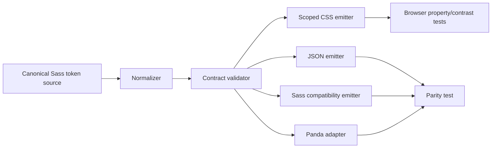

---
doc_meta:
  id: TDD-ui-platform-tokens-003
  title: Theme and Token Output
  owner: UI Platform Team
  version: 1.0.0
  status: approved
  classification: public
  parent_sad: SAD-003
  review_cycle_days: 30
  created_date: 2026-09-28
  last_reviewed: 2026-10-23
---

# TDD-ui-platform-tokens-003: Theme and Token Output

## Purpose

Define one deterministic token pipeline that implements the centrally governed
three-tier language and emits complete, type-correct, scoped, and equivalent
CSS, JSON, Sass, and Panda-facing contracts for every supported theme.

## Scope

In scope: core values, semantic mappings, justified component aliases, default
and achromatic themes, light/dark modes, font metadata, CSS custom properties,
stable `@scnx/system/tokens/*` entries, validation, migration, and release
evidence. DTCG interchange is a target output only after its generator passes
parity. Product tokens and component CSS rules are out of scope.

## Technical Context

Sass maps are the baseline source; the Tier-1 color maps are generated into one
Sass module (decision record "Palette generation"). The baseline has undefined Panda references,
malformed shadow serialization, unequal public shadow sets, legacy names, and
an invalid achromatic expression. OKLCH does not by itself prove contrast, and
alpha results depend on their actual backgrounds.

| ID      | Contract                                                                                 |
| :------ | :--------------------------------------------------------------------------------------- |
| TKN-001 | Every token has one canonical logical name, type, tier, and owner.                       |
| TKN-002 | Tier 2 never references Tier 3; Tier 3 resolves to Tier 2.                               |
| TKN-003 | Every supported theme/mode exposes the identical public Tier-2 key set and types.        |
| TKN-004 | CSS, JSON, Sass, and Panda outputs derive from one normalized dictionary and agree.      |
| TKN-005 | Every reference resolves; every substituted CSS value parses for its consuming property. |
| TKN-006 | Actual foreground/background and non-text pairs pass applicable WCAG 2.2 gates.          |
| TKN-007 | A focus shadow supplements but never replaces a visible outline.                         |
| TKN-008 | Generated artifacts are reproducible and never hand-edited.                              |

## Component Design



| Component          | Responsibility                                                                                            |
| :----------------- | :-------------------------------------------------------------------------------------------------------- |
| normalizer         | Convert source maps into ordered typed records; reject duplicate logical names                            |
| contract validator | Enforce central grammar, legal type, tier direction, references, theme coverage, and alias review records |
| emitters           | Serialize the same normalized record set into target formats                                              |
| browser verifier   | Load packed CSS and verify computed values, pairs, roots, and coexistence                                 |
| migration reporter | Map removed baseline names to canonical names and enumerate affected source callsites                     |

The canonical grammar remains owned by STD-UIP-TKN-001. This TDD implements it
and does not fork its vocabulary.

## Data Model

```ts
type TokenRecord = {
  name: string; // canonical dotted name
  cssName: `--ds-${string}`;
  tier: 1 | 2 | 3;
  type:
    | "color"
    | "dimension"
    | "duration"
    | "cubicBezier"
    | "fontFamily"
    | "fontWeight"
    | "number"
    | "shadow"
    | "strokeStyle";
  purpose: string;
  value?: string | number | string[];
  reference?: string;
  component?: string; // required only for Tier 3
  themes: Record<string, Record<string, string | number | string[]>>;
  lifecycle: "candidate" | "stable" | "deprecated";
  replacement?: string;
};
```

Canonical public examples include
`color.primary.surface.solid.default`, `effect.shadow.low`,
`dimension.z-index.modal`, and `dialog.root.z-index.default`. The exact grammar,
allowed vocabularies, role/emphasis/state compatibility, and required alias
review fields are read from the central standards rather than restated locally.

Theme identity is a URL-safe `<theme-id>` identifying the brand; mode is the
separate `light` or `dark` dimension. A public theme is a complete mapping over
the public semantic key set for every declared mode; inheritance may be used in
source only when the resolved output is complete and its parent is explicit.

## API / Interface

| Entry                                      | Content                                                            |
| :----------------------------------------- | :----------------------------------------------------------------- |
| `@scnx/system/tokens/css/<theme-id>.css`   | Scoped public CSS variables for one brand across declared modes    |
| `@scnx/system/tokens/json/<theme-id>.json` | Typed normalized token records for one brand across declared modes |
| `@scnx/system/tokens/scss`                 | Supported Sass variables/functions generated from the same records |

CSS variables use `--ds-` plus the canonical kebab-case path. Public variables
are emitted under
`[data-scnx-theme="<theme-id>"][data-scnx-resolved-mode="<mode>"]`. The theme
ID and resolved mode are separate selector dimensions; `system` is a preference
resolved by the provider and never an emitted CSS mode. A separately exported
single-brand compatibility asset may use `:root` and is excluded from
multi-brand/federated support. Raw Tier-1 scales and internal generator helpers
are not public compatibility contracts.

## Algorithms / Logic

### Normalize and resolve

1. Parse source without coercing quoted keys or units.
2. Create a record for every leaf and reject duplicate canonical/css names.
3. Validate tier, type, grammar, legal vocabulary, and alias justification.
4. Build a directed reference graph; reject cycles and invalid tier direction.
5. Resolve each theme/mode to a complete public semantic map.
6. Reject missing, extra, or differently typed public keys across themes.
7. Serialize typed values with property-aware functions; never use
   `meta.inspect` as a general CSS serializer.
8. Emit all formats from the same ordered records and hash them.

### CSS and visual validation

Parse every stylesheet, collect declarations, and reject syntax errors,
duplicate conflicting declarations, undefined references, or selectors outside
the allowed root. In a browser, substitute each public token into representative
properties (`color`, `background`, `border`, `box-shadow`, typography, spacing,
motion, and z-index) and require a valid computed value.

Contrast evaluates named semantic pairs and all interaction states against
their actual resolved background. Alpha colors are composited before contrast
calculation. Every color pair a styled specification renders, per option and
non-disabled state, is also a case (`rendered-by-component`, TDD styled CS5),
because the doctrine's pairs alone missed a component using another scheme's
label. The neutral strong border in its default state is the boundary of
controls with no other visual indicator, such as text inputs, and is tested at
3:1 against every declared neutral surface (STD-UIP-TKN-001 2.2.0, WCAG 2.2 SC
1.4.11); on 2026-10-20 the light neutral step 8 moved from L 0.64 to 0.63 to
meet it (minimum 3.11:1, from 2.99:1). A color outside sRGB is tested on every
display path, as decided below.

#### Decision record: the label of a disabled solid fill

STD-UIP-TKN-001 "Semantic Usage Doctrine": `contrast` is the text or icon color
"designed to sit on a `solid` surface of the same scheme", and each `contrast`
token is tested against that surface "in each theme and state". Until
2026-10-22 the recipe gave every state of `contrast` the full-contrast label
(white, or neutral step 12 or 1 for a dark-label scheme), while
`solid-state-step` gives the disabled fill the quiet step 3. In the light
default theme a disabled primary label measured about 1.2:1 on its fill.

| ID  | Decision                                                                                                                                                                                                                                    | Source                                           | Tradeoff                                                                                                                                                            |
| :-- | :------------------------------------------------------------------------------------------------------------------------------------------------------------------------------------------------------------------------------------------ | :----------------------------------------------- | :------------------------------------------------------------------------------------------------------------------------------------------------------------------ |
| SD1 | `text.contrast.disabled` and `icon.contrast.disabled` of every scheme take the neutral disabled text step (step 8 of the neutral scale), the value of `color.neutral.text.default.disabled`. The disabled fill keeps its quiet scheme step. | STD-UIP-TKN-001, "Semantic Usage Doctrine"       | A disabled label drops the scheme's chroma, so disabled controls read alike across schemes; the fill keeps a trace of the scheme. The ratio becomes 2.9:1 to 4.7:1. |
| SD2 | The gate does not add a contrast minimum for disabled pairs; a unit test pins the pairing and fails below 2.5:1.                                                                                                                            | WCAG 2.2 SC 1.4.3 (disabled controls are exempt) | 2.5:1 is a regression floor for this recipe, not a conformance claim.                                                                                               |

#### Decision record: display paths of out-of-gamut colors

How STD-UIP-TKN-001 revision 2.3.0 ("Semantic Usage Doctrine") is implemented in
`scripts/tokens/color.mjs`. On 2026-10-20, 94 token names lie outside sRGB; the packed
token stylesheets hold 41 distinct such values.

| ID  | Decision                                                                                                                                                                                                                                                                                                                                                                                                                                                                                                                                                                                                                                                                                                                                                    | Sources                  | Tradeoff                                                                                                                                                                                                                                                                           |
| :-- | :---------------------------------------------------------------------------------------------------------------------------------------------------------------------------------------------------------------------------------------------------------------------------------------------------------------------------------------------------------------------------------------------------------------------------------------------------------------------------------------------------------------------------------------------------------------------------------------------------------------------------------------------------------------------------------------------------------------------------------------------------------- | :----------------------- | :--------------------------------------------------------------------------------------------------------------------------------------------------------------------------------------------------------------------------------------------------------------------------------- |
| G1  | No fallback value is declared for a color outside sRGB. Every supported browser parses `oklch()` (Baseline Widely available since 2025-11-09 [3]; `support-matrix.json` is Baseline Widely available on 2026-10-03), and the browser's own gamut handling is the fallback.                                                                                                                                                                                                                                                                                                                                                                                                                                                                                  | STD-UIP-TKN-001 [5]; [3] | No `@media (color-gamut: p3)` or `@supports` duplicate is emitted, so the CSS stays one declaration per token. What a display actually shows is then the browser's choice, which G2 tests.                                                                                         |
| G2  | Contrast is evaluated on four display paths: sRGB clipped, sRGB gamut mapped with the CSS Color 4 algorithm, Display P3 clipped, and Display P3 gamut mapped. The lowest ratio counts, and a finding names its path. CSS Color 4 specifies gamut mapping for an RGB display or a unorm8 canvas [1]. `scripts/browser-gamut.mjs` paints each of those values into an sRGB 2D canvas in every engine and records which result it matches (`gamut-report.json`, evidence row 4). On 2026-10-20, Chromium 153, Firefox 155, and WebKit 26.6 clipped instead: of the 41 values, 14 (Chromium) and 15 (Firefox, WebKit) matched the clipped color more closely and at most 1 the mapped color, with an OKLCH lightness difference of up to 0.013 (CI run of #74). | STD-UIP-TKN-001 [3]; [1] | The spec and the engines disagree, so the gate tests both. The canvas measures a script-visible surface, not the display pipeline itself, which no script can read [1]. CI repeats the measurement on every change.                                                                |
| G3  | Alpha colors are composited in the gamma-encoded space of each path, and relative luminance is taken in that path's color space [2]; for an sRGB color every path gives the same ratio.                                                                                                                                                                                                                                                                                                                                                                                                                                                                                                                                                                     | STD-UIP-TKN-001 [4]; [2] | WCAG defines the sRGB formula and asks authors to evaluate in sRGB "Unless it is known that another color space will be used" [2]; the P3 paths extend the same definition to a P3 display. Where a browser composites in another space, the composited ratio can differ slightly. |

On 2026-10-20 all 2,376 contrast cases pass on every path. A color that passes
only when gamut mapped now fails: `oklch(0.66 0.3 105)` on white is 3.05:1
mapped and 2.99:1 clipped, a unit-test case.

#### Decision record: palette generation

How the Tier-1 color scales are produced (TKN-008: one producer, never hand
edited) and how their twelve steps map to Tier-2 roles. Until 2026-10-23 the
scales were written by `scripts/generate-palette.mjs`, which no build or CI
step ran, and the light neutral step 8 had since been edited by hand (0.64 to
0.63, the 3:1 boundary of 2026-10-20), so a regeneration would have undone a
conformance fix. Its comment called the scale "Radix 12-step aligned", but no
document chose Radix and the values diverged from Radix Colors 3.0.0 by up to
0.26 OKLab: steps 3-8 carried chroma up to 0.25 (Radix at most 0.14), the light
neutral step 11 was Radix's step 12, the dark backgrounds started at L 0.07, and
step 9 changed by 0.12-0.14 OKLab between modes, so the brand did too.

| ID   | Decision                                                                                                                                                                                                                                                                                                                                                                                                                                                                                                                                                                                                                                                                                                                                                                                                                                                                                                                                                                                           | Sources                                                       | Tradeoff                                                                                                                                                                                                                                                                                                                                                                                                                                                                        |
| :--- | :------------------------------------------------------------------------------------------------------------------------------------------------------------------------------------------------------------------------------------------------------------------------------------------------------------------------------------------------------------------------------------------------------------------------------------------------------------------------------------------------------------------------------------------------------------------------------------------------------------------------------------------------------------------------------------------------------------------------------------------------------------------------------------------------------------------------------------------------------------------------------------------------------------------------------------------------------------------------------------------------- | :------------------------------------------------------------ | :------------------------------------------------------------------------------------------------------------------------------------------------------------------------------------------------------------------------------------------------------------------------------------------------------------------------------------------------------------------------------------------------------------------------------------------------------------------------------ |
| PG1  | `scripts/palette/generate.mjs` is the only producer of `src/styles/abstracts/_core-palette.generated.scss`, which `_core-token.scss` uses as `$color`. Its input is `scripts/palette/palette.config.json` (a seed and label polarity per hue, the mode backgrounds, the neutral surfaces text sits on, the margin, the sRGB-clip budget, and the emitted precision); unknown or missing keys fail, and the contrast minimums come from `tokens.config.json`, so the generator and the gate share one target. The previous generator, its library, and the unused `_core-token-new.scss` are removed.                                                                                                                                                                                                                                                                                                                                                                                               | TKN-008; SAD-003 4.2                                          | Changing a color means changing a seed or a rule, never a value; a one-off value needs a configuration field and a decision.                                                                                                                                                                                                                                                                                                                                                    |
| PG2  | Each scale's shape is the Radix Colors custom-palette algorithm [5], ported from its source: mix the two reference scales nearest the seed, rotate hue and scale chroma to the seed, and move the lightness progression to the mode's background, on the Display P3 scales of `@radix-ui/colors` 3.0.0 [6]. `fixtures/radix-golden.json` is the output of the original source for four seeds in both modes, and the port must reproduce it. One deviation: a chromatic scale keeps the hue offsets of its reference scale instead of one flat hue, so darker yellows turn toward amber as Radix's hand-tuned scales do (Radix yellow 11 sits 20 degrees from its step 9); gray scales stay flat. The steps keep Radix's uses [4]: 1-2 backgrounds, 3-5 component fills (normal, hover, pressed or selected), 6-8 borders (non-interactive, interactive, strong and focus), 9-10 solid fills, 11-12 text (low and high contrast). The backgrounds are white and `#111111` (Radix gray dark step 1). | [4]; [5]; [6]                                                 | Thirty reference scales tuned by hand over several Radix releases carry the perceptual design; no curve here is a tuned guess. The scales follow Radix's uses, not its values: PG3-PG5 move steps where Radix does not meet WCAG 2.2.                                                                                                                                                                                                                                           |
| PG3  | Steps 9 (solid), 10 (hover), and 10B (pressed) are one ramp shared by both modes. Step 9 is the seed, moved away from its label only as far as the label needs; 10 and 10B each take Radix's hover step (lightness by 0.03 / (L + 0.1)) away from the label. The label is white, or for a `dark` polarity neutral step 12 of the light axis, in both modes. The label meets 4.5:1 plus the margin on all three steps.                                                                                                                                                                                                                                                                                                                                                                                                                                                                                                                                                                              | WCAG 2.2 SC 1.4.3; [7]; [5]                                   | Contrast only grows from rest to pressed, and the brand fill is the same in both modes, as Carbon's primary button is in all four of its themes [7]. A dark-mode hover therefore darkens; lightening it toward a white label would have forced the blue seed from L 0.565 to 0.474 in both modes to keep 4.5:1. Brand blue `#0a6cf2` keeps its seed (4.73:1); red, orange, green, teal, magenta, and neutral move darker by 0.02 to 0.11 L.                                     |
| PG4  | Steps 11 and 12 of every scale meet 4.5:1 plus the margin on every neutral surface of the mode and on steps 1-5 of their own scale, measured with the gate's function on its four display paths (`scripts/tokens/color.mjs`); step 12 stays at least 0.02 L beyond step 11.                                                                                                                                                                                                                                                                                                                                                                                                                                                                                                                                                                                                                                                                                                                        | WCAG 2.2 SC 1.4.3; STD-UIP-TKN-001, "Semantic Usage Doctrine" | Radix guarantees APCA Lc 60 and 90 on step 2 [4], not WCAG: its blue 11 and amber 11 measure 4.47:1 and 4.45:1 on step 2, so the solver darkens light text steps by a few hundredths of L.                                                                                                                                                                                                                                                                                      |
| PG5  | Neutral step 8, the control boundary, meets 3:1 plus the margin on every neutral surface of the mode (3.05:1 in both modes).                                                                                                                                                                                                                                                                                                                                                                                                                                                                                                                                                                                                                                                                                                                                                                                                                                                                       | STD-UIP-TKN-001 2.3.0; WCAG 2.2 SC 1.4.11                     | Radix slate 8 is 1.86:1 on slate 1; the light step 8 is therefore much darker than step 7 (L 0.63 against 0.85). Chromatic step 8 is not constrained, as scheme borders are not tested for 3:1.                                                                                                                                                                                                                                                                                 |
| PG6  | Every color is gamut mapped into Display P3 by the CSS Color 4 algorithm, and while its sRGB-clipped rendering is more than 0.02 OKLab from its sRGB gamut-mapped rendering, its chroma is reduced at constant lightness and hue. Rounding to the emitted precision gives back chroma until the value is inside Display P3.                                                                                                                                                                                                                                                                                                                                                                                                                                                                                                                                                                                                                                                                        | ADR-UIP-TKN-002 4.1; G1-G2                                    | Engines clip (G2), so the budget bounds what an sRGB display shows without a fallback declaration. In the packed CSS, 23 distinct values lie outside sRGB (41 before), and Chromium paints 22 of them identically clipped and mapped.                                                                                                                                                                                                                                           |
| PG7  | Alpha steps 1A-12A are, per step, the smallest 8-bit alpha at which an sRGB color composites over neutral step 1 of the mode to the step, each channel solved separately, with the browser's per-term rounding.                                                                                                                                                                                                                                                                                                                                                                                                                                                                                                                                                                                                                                                                                                                                                                                    | ADR-UIP-TKN-002 4.2                                           | Radix's solver moves every channel in one direction, so a target whose channels move both ways from a tinted background (orange over a blue-gray) missed by up to 15 of 255; this one reproduces every step within one level after OKLCH rounding.                                                                                                                                                                                                                              |
| PG8  | The token-gate job runs `generate.mjs --check`, which fails when the committed module differs from a fresh generation or when any constraint of PG3-PG7, the monotonic order of steps 1-8 away from the background, or the disabled floor of SD2 does not hold, and uploads `palette-report.json`.                                                                                                                                                                                                                                                                                                                                                                                                                                                                                                                                                                                                                                                                                                 | TKN-008; Failure Handling                                     | Every constraint is verified on the emitted, rounded values, independently of the order in which they were solved.                                                                                                                                                                                                                                                                                                                                                              |
| PG9  | The recipe maps roles to the same steps in both modes; only values differ. Surface subtle, default, strong: 2, 3, 4 (hover +1, pressed +2, selected +1, disabled 3). Border subtle, default, strong: 6, 7, 8 (selected +1; focus 11 and 12, which PG4 puts above 3:1). Text and icon subtle 11, default and strong 12 (hover 12). Solid: 9, 10, 10B (selected 10, disabled 3). Elevation: light canvas 1, raised and floating white, sunken 2; dark canvas 1, raised and floating 2, sunken 1. Shadows take neutral step 12 of the light axis in light mode and black in dark mode, with opacities by emphasis (light 0.07, 0.11, 0.16; dark 0.3, 0.42, 0.55), hover one level up and pressed one down.                                                                                                                                                                                                                                                                                            | [4]; STD-UIP-TKN-001, "Semantic Usage Doctrine"               | Steps run away from the background in each mode, so the mapping is never inverted. A dark floating panel on step 3 would make a step-3 hover invisible on it, so panels stay on the background steps and shadow and border carry depth. Text `strong` equals `default`: Radix has two text steps and step 12 is already the high-contrast one, so strong emphasis is typographic (`typography.weight`). A shadow in a dark surface step was lighter than the canvas it fell on. |
| PG10 | The recipe no longer searches for a solid step by contrast: `solid-plan`, its per-mode design step (light 10, dark 9), the neutral label flip in dark mode, and the Sass contrast module are removed, because PG3 proves the pairs and the gate re-verifies them. The component fixture tells modes apart by the secondary Button and requires the primary Button to be identical in light and dark.                                                                                                                                                                                                                                                                                                                                                                                                                                                                                                                                                                                               | PG3; TDD styled CS4                                           | One contrast implementation, the gate's, instead of a second one in Sass that clipped instead of mapping.                                                                                                                                                                                                                                                                                                                                                                       |

The gate reports against the ratified STD-UIP-TKN-001 revision (`STANDARD` in
`scripts/tokens/grammar.mjs`, emitted into the token JSON), which was 2.1.0
(`af6462e`) until 2026-10-20 and is now 2.2.0 (`a93e28f`): the grammar of section
3 is identical in both. It moves to 2.3.0 only when that revision is ratified.

## Configuration

Versioned configuration declares theme IDs, modes, public token families,
browser support, color fallback policy, font assets, alias review records, and
selector roots. An alias review records semantic purpose, Tier-2 fallback,
theme/state coverage, and migration impact; no numerical alias cap is implied.
Unknown configuration keys fail. Environment variables cannot alter public
token values during a release build.

## Failure Handling

| Failure                          | Disposition                                                           |
| :------------------------------- | :-------------------------------------------------------------------- |
| Parse/type/reference/cycle error | Stop generation; emit source path and reference chain                 |
| Theme key-set mismatch           | Block all theme artifacts from that coordinated release               |
| Invalid CSS substitution         | Block affected theme and component promotion                          |
| Contrast failure                 | Block affected semantic pair/state; do not silently adjust at runtime |
| Missing font/license             | Remove reference or supply governed asset before packing              |
| Emitter parity mismatch          | Treat normalized dictionary as unshippable                            |
| Unexpected generated diff        | Fail reproducibility gate and investigate producer ownership          |

## Observability

The token report records source SHA, normalized-root hash, record count by tier
and type, theme/mode key counts, unresolved reference count, alias count,
contrast-case count/failures, CSS parse failures, output sizes, and each output
digest. Logs identify token and source path but never dump the entire palette on
success. Main/release alerts fire on any previously green contract regression.

## Testing Strategy

- Unit: grammar adapter, name conversion, type serializer, reference graph,
  inheritance, alias review validation, alpha compositing, contrast calculation.
- Property/boundary: empty maps, quoted numeric keys, deep paths, cycle chains,
  zero values, multi-shadow lists, font stacks, wide-gamut fallback.
- Negative fixtures: legacy names, unknown roles/states, Tier-3 back-reference,
  missing theme key, wrong type, invalid CSS, duplicate CSS name.
- Golden/parity: stable ordered JSON, Sass/Panda/CSS name/value equivalence,
  reproducible hashes.
- Packed browser: every theme/mode, two roots together, computed properties,
  focus/forced-colors, font loading, no selector leakage.
- Accessibility: WCAG 2.2 SC 1.4.3 and 1.4.11 pairs for default, hover,
  pressed, selected, disabled, and focus states where applicable.

## Performance Notes

Record normalization/build time, peak memory, token count, CSS/JSON bytes by
theme and encoding, unused generated variants in named consumer scenarios, and
style-recalculation cost for theme changes. Budgets are scenario-specific.

## Security Notes

Token input is data, never executable code. Emitters reject strings capable of
escaping declarations or selectors. Outputs contain no secrets or user data.
Font assets carry license and digest records. No runtime string evaluation,
network fetch, or arbitrary consumer-supplied token execution is permitted.

## Operational Notes

Generated-output ownership, token migration, contrast triage, missing-asset
repair, and release rollback have runbooks. A released token set is immutable.
Supported prior themes remain available for their compatibility window.

## Rollout and Compatibility

Before v1, generate a complete baseline inventory, replace malformed/legacy
names, update all repository callsites atomically, and publish no compatibility
aliases unless an external consumer is proven. Then enable validation in report
mode once, fix all findings, switch to blocking mode, pack outputs, rehearse a
consumer migration, and promote an exact digest with human authority.

## Open Questions

- Does an independent token-only consumer justify a third package after v1?
- Which DTCG version and resolver behavior passes full output parity?

These are bounded future decisions; v1 remains Sass-source with generated
multi-format outputs until evidence closes them.

## Traceability

Architecture authority: SAD-003; ADR-UIP-PLT-001 and ADR-UIP-TKN-001/002/003;
STD-GLB-FE-005/009 and STD-UIP-TKN-001/002. Lifecycle status in
`scnehaux-architecture` controls authority. Execution:
[PLAN](../../PLAN.md) P0 rows 4 and 11. Related designs: packaging, CSS delivery,
and theme runtime.

References (retrieved 2026-10-20):

1. W3C, CSS Color Module Level 4, "Gamut Mapping" and "CSS Gamut Mapping to an
   RGB Destination", at csswg-drafts commit
   `160a00acff045d99796606f502812c9462e110e2`, cited in STD-UIP-TKN-001 [3]:
   out-of-gamut values "must be converted to an in-gamut color" for a display;
   the CSS algorithms apply to "an RGB display" and "a canvas, with unorm8
   backing store"; its test annotation says "Actual values of color are not
   exposed to script, making this hard to test in an automated manner."
2. W3C, WCAG 2.2, definition "relative luminance", at w3c/wcag commit
   `457cece22d8219be32d29c5c1313e71aa6b61eae`, cited in STD-UIP-TKN-001 [4]:
   "the relative brightness of any point in a colorspace, normalized to 0 for
   darkest black and 1 for lightest white"; "Unless it is known that another
   color space will be used to process and display the content, authors should
   evaluate using sRGB colorspace."
3. web-features 3.43.0, feature `oklab`, cited in STD-UIP-TKN-001 [5]:
   `baseline_high_date` 2025-11-09, covering `css.types.color.oklch`.

References for "Palette generation" (retrieved 2026-10-23):

4. Radix Colors, "Understanding the scale",
   `data/colors/docs/palette-composition/understanding-the-scale.mdx` at
   radix-ui/website commit `402e749613ab2e7ab7139c65b0029842b0360f07`:
   "Steps `1` and `2` are designed for app backgrounds"; "Step `3` is for
   normal states. Step `4` is for hover states. Step `5` is for pressed or
   selected states"; "Step `6` is designed for subtle borders on components
   which are not interactive", "Step `7` [...] on interactive components",
   "Step `8` is designed for stronger borders on interactive components and
   focus rings"; "Step `9` has the highest chroma of all steps"; "Step `10` is
   designed for component hover states"; "Step `11` is designed for
   low-contrast text. Step `12` is designed for high-contrast text"; "Steps
   `11` and `12` [...] are guaranteed to Lc 60 and Lc 90 APCA contrast ratio on
   top of a step `2` background".
5. Radix, `components/generate-radix-colors.tsx`, same commit (MIT License,
   Copyright (c) 2022 WorkOS): `getScaleFromColor`, `getButtonHoverColor`
   (`L - 0.03 / (L + 0.1)`), `transposeProgressionStart`, `getAlphaColor`.
6. `@radix-ui/colors` 3.0.0 (MIT), the `*P3` and `*DarkP3` scales; `grayDark`
   step 1 is `#111111`.
7. IBM Carbon, `@carbon/themes` 11.84.0, `scss/generated/_button-tokens.scss`:
   `$button-primary` `#0f62fe`, `$button-primary-hover` `#0050e6`, and
   `$button-primary-active` `#002d9c` in each of `white-theme`, `g-10`,
   `g-90`, and `g-100`.
